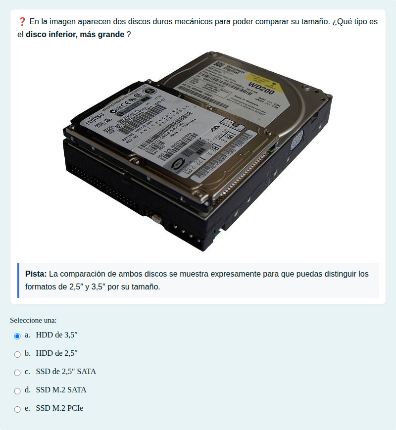
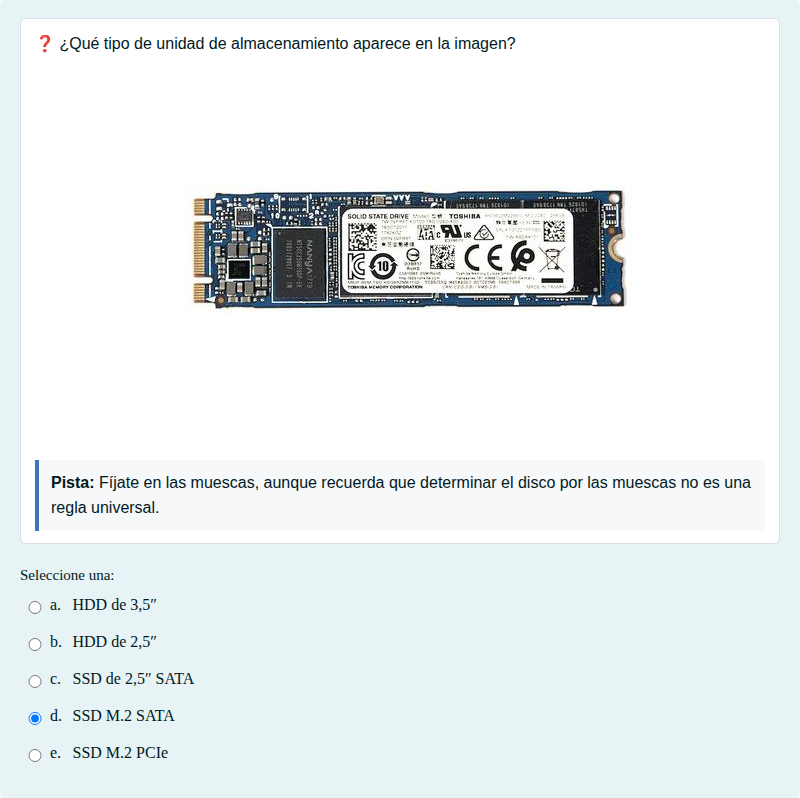
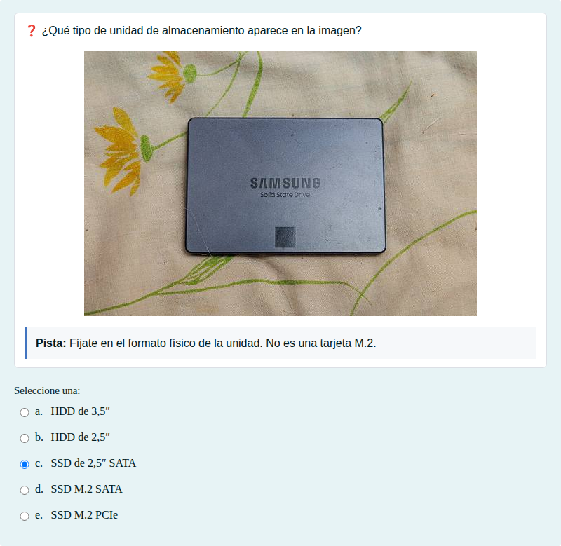

# Almacenamiento: HDD, SSD, formatos y conectores

Diferencias entre HDD y SSD e identificación de su formato (2,5″, 3,5″, M.2) y su conexión (SATA o PCIe).

## Contenido

Ficheros de preguntas disponibles en esta actividad:

### [almacenamiento-hdd-ssd-formatos-y-conectores.xml](almacenamiento-hdd-ssd-formatos-y-conectores.xml)

|   | Tipo              | Cantidad                   |
| - | ----------------- | -------------------------- |
|  | [Selección múltiple](#selección-múltiple) | 4 |
|   | **TOTAL**         | 4 |

#### Selección múltiple

