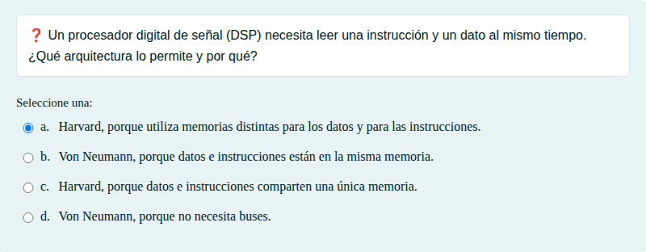
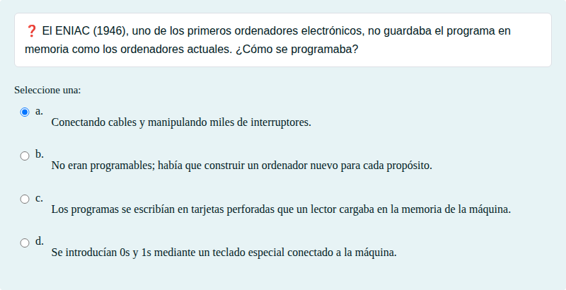
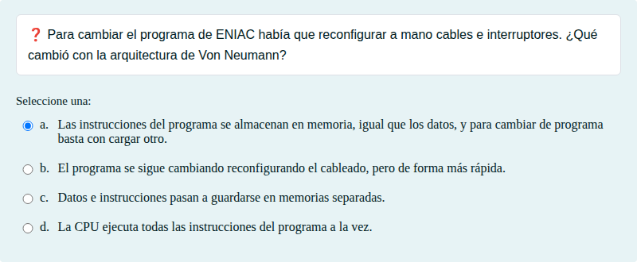
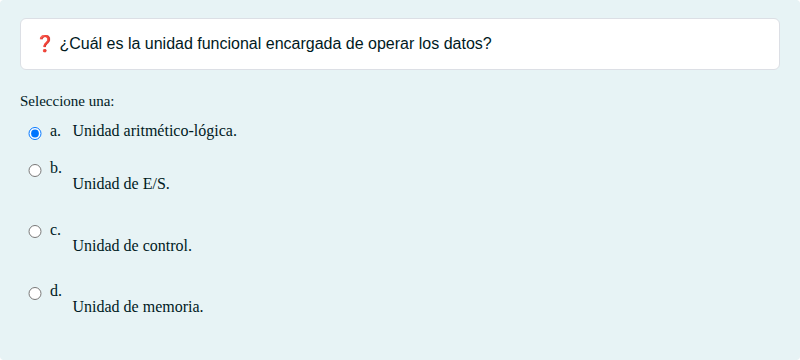

# Arquitectura de Von Neumann y Harvard: elegir y relacionar

Programa almacenado, arquitecturas Von Neumann y Harvard, buses, ciclo de instrucción y niveles de lenguaje, eligiendo o relacionando.

## Contenido

Ficheros de preguntas disponibles en esta actividad:

### [arquitectura-de-von-neumann-y-harvard-elegir-y-relacionar.xml](arquitectura-de-von-neumann-y-harvard-elegir-y-relacionar.xml)

|   | Tipo              | Cantidad                   |
| - | ----------------- | -------------------------- |
|  | [Selección múltiple](#selección-múltiple) | 5 |
|   | **TOTAL**         | 5 |

#### Selección múltiple

