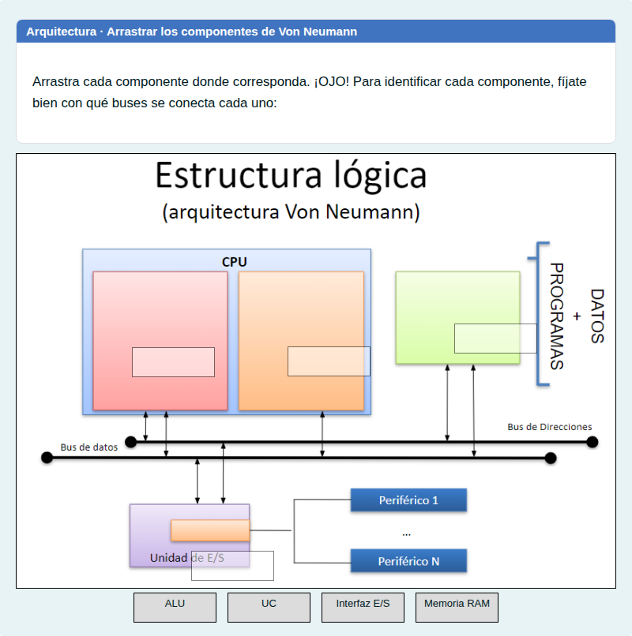
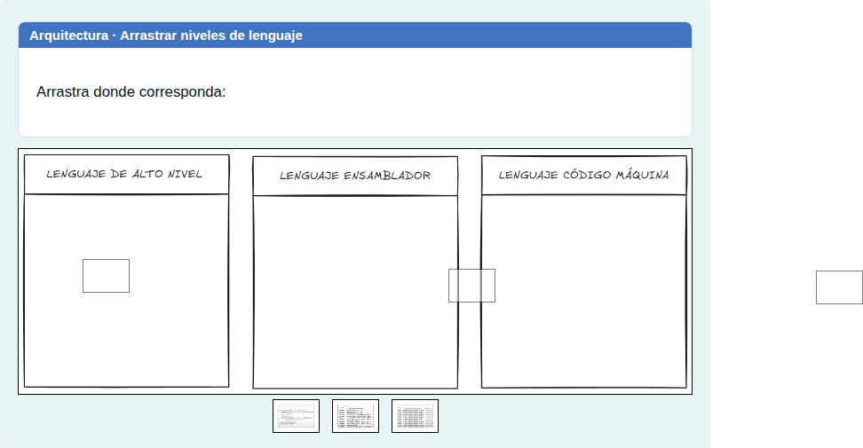
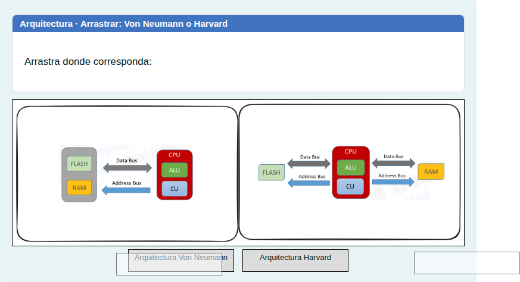

# Arquitectura de Von Neumann y Harvard: escribir y arrastrar

Componentes de la CPU, buses y arquitecturas, escribiendo el nombre o arrastrándolo sobre un esquema.

## Contenido

Ficheros de preguntas disponibles en esta actividad:

### [arquitectura-de-von-neumann-y-harvard-escribir-y-arrastrar.xml](arquitectura-de-von-neumann-y-harvard-escribir-y-arrastrar.xml)

|   | Tipo              | Cantidad                   |
| - | ----------------- | -------------------------- |
|  | [Respuesta corta](#respuesta-corta) | 4 |
|  | [Arrastrar y soltar imagen o texto](#arrastrar-y-soltar-imagen-o-texto) | 3 |
|   | **TOTAL**         | 7 |

#### Respuesta corta

#### Arrastrar y soltar imagen o texto

