# El sistema informático: componentes, operaciones y capas

Preguntas de situación sobre hardware, software, datos y personas, las operaciones de un sistema informático y sus capas.

## Contenido

Ficheros de preguntas disponibles en esta actividad:

### [el-sistema-informatico-componentes-operaciones-y-capas.xml](el-sistema-informatico-componentes-operaciones-y-capas.xml)

|   | Tipo              | Cantidad                   |
| - | ----------------- | -------------------------- |
|  | [Selección múltiple](#selección-múltiple) | 15 |
|  | [Verdadero/Falso](#verdaderofalso) | 2 |
|   | **TOTAL**         | 17 |

#### Selección múltiple

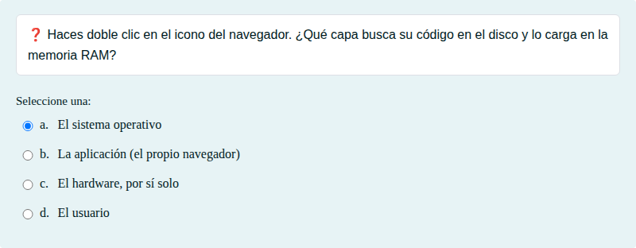

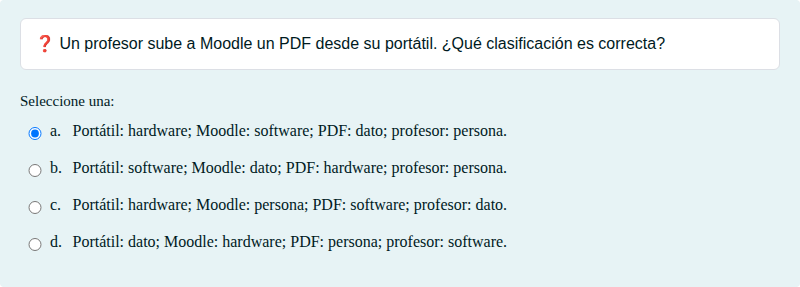

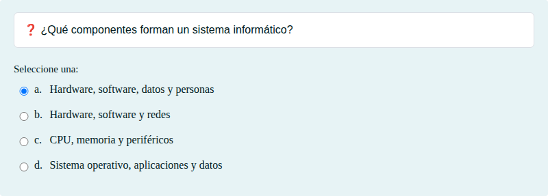

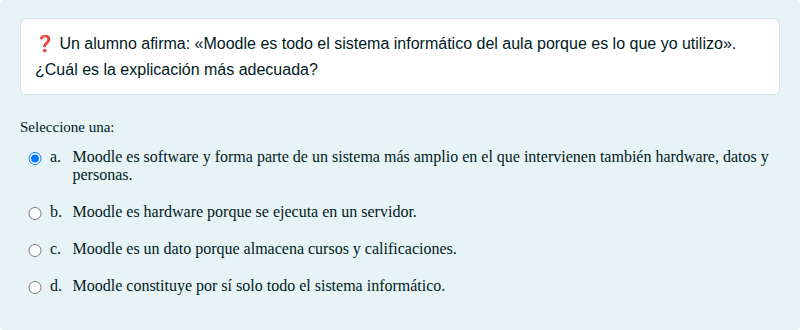

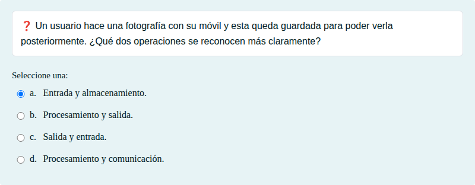

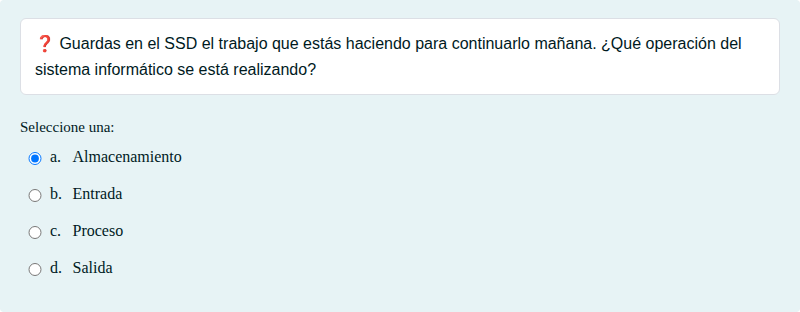

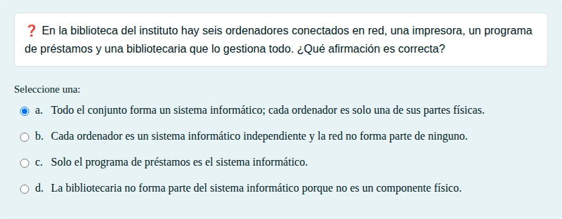

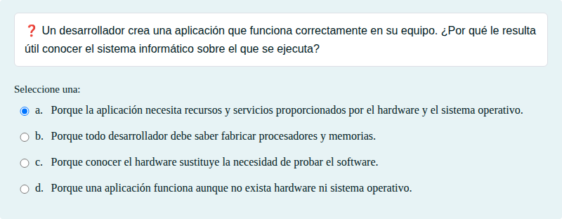

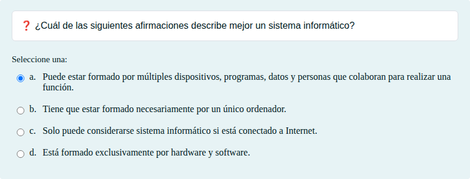

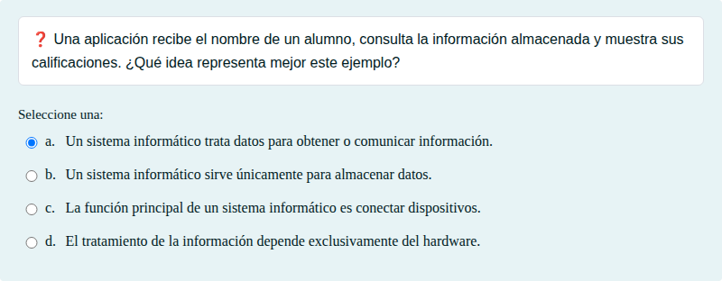

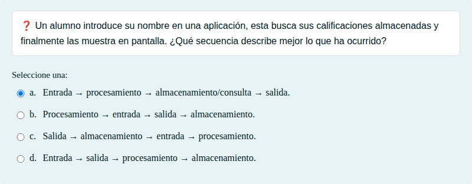

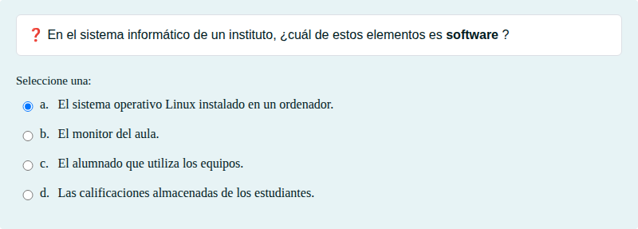

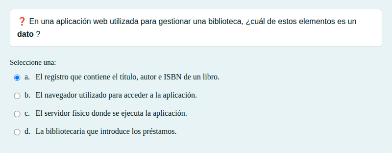

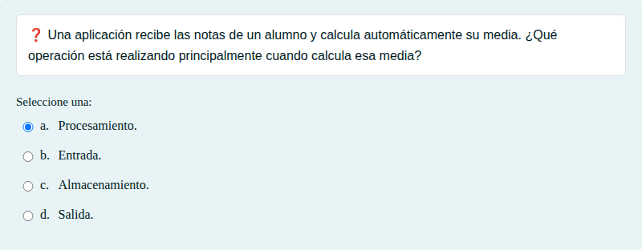

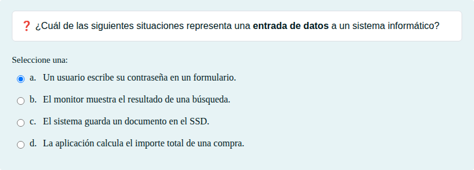

#### Verdadero/Falso

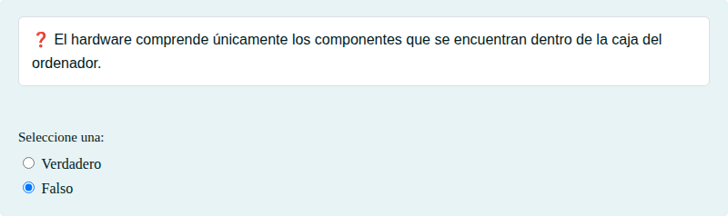

