# Binario y hexadecimal con ayuda

Conversiones entre decimal y binario con la tabla de pesos, y cuántos números se representan con n bits.

## Contenido

Ficheros de preguntas disponibles en esta actividad:

### [binario-y-hexadecimal-con-ayuda.xml](binario-y-hexadecimal-con-ayuda.xml)

|   | Tipo              | Cantidad                   |
| - | ----------------- | -------------------------- |
|  | [Respuestas anidadas (Cloze)](#respuestas-anidadas-cloze) | 13 |
|   | **TOTAL**         | 13 |

#### Respuestas anidadas (Cloze)

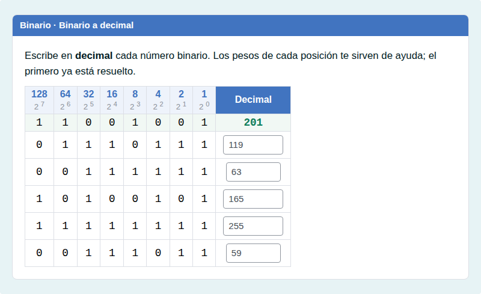

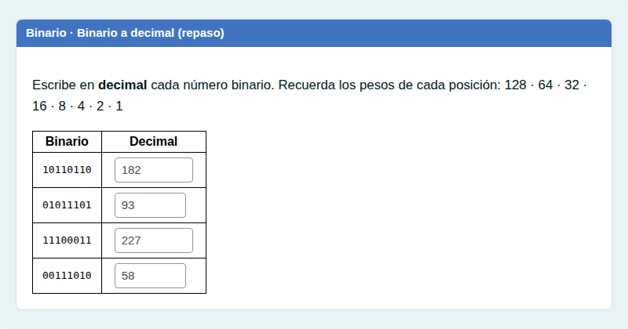

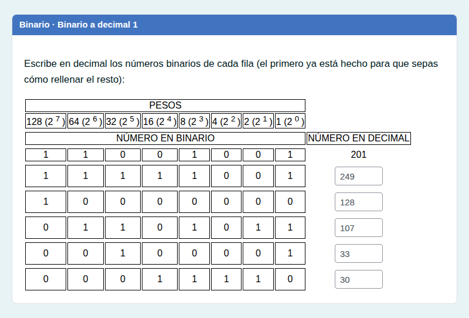

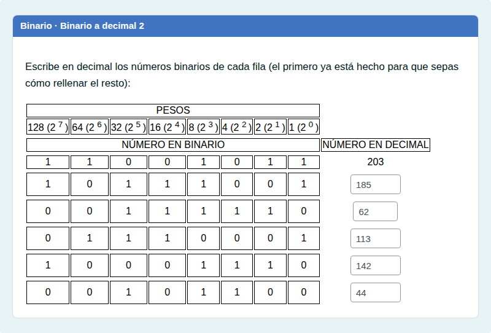

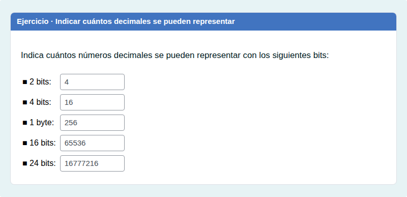

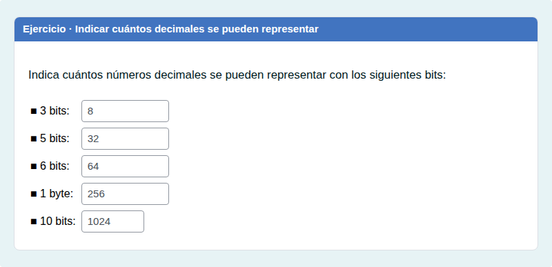

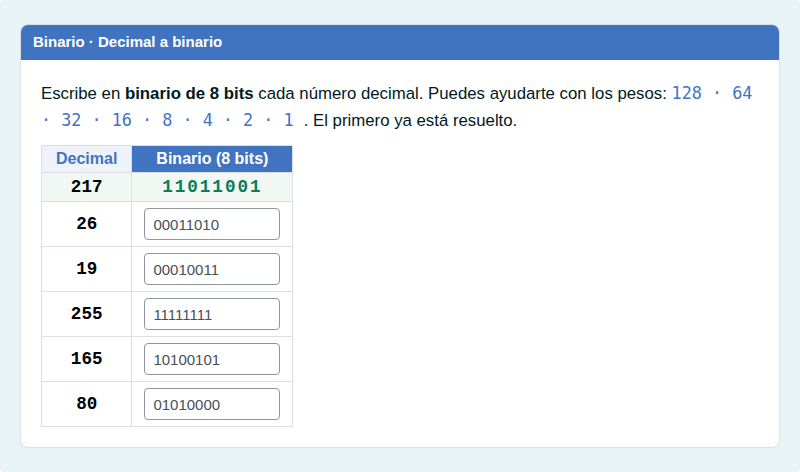

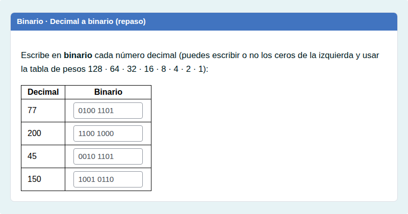

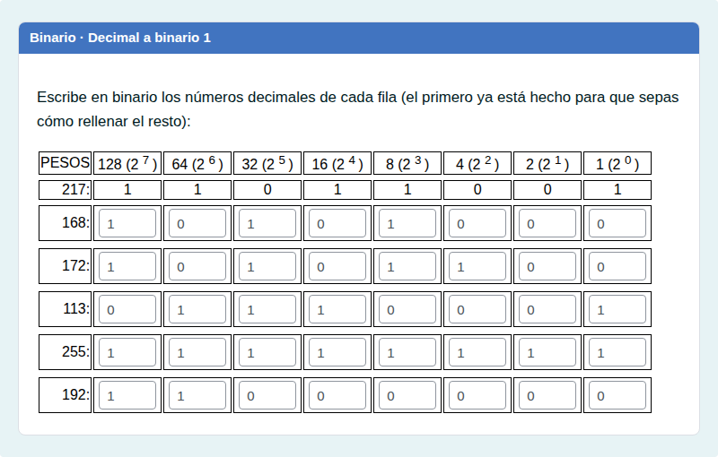

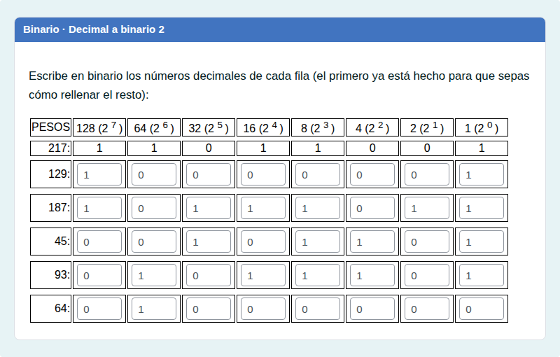

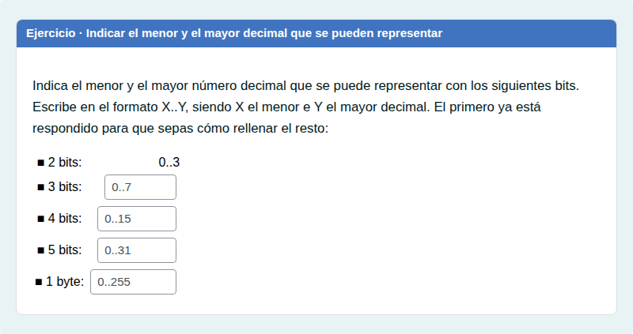

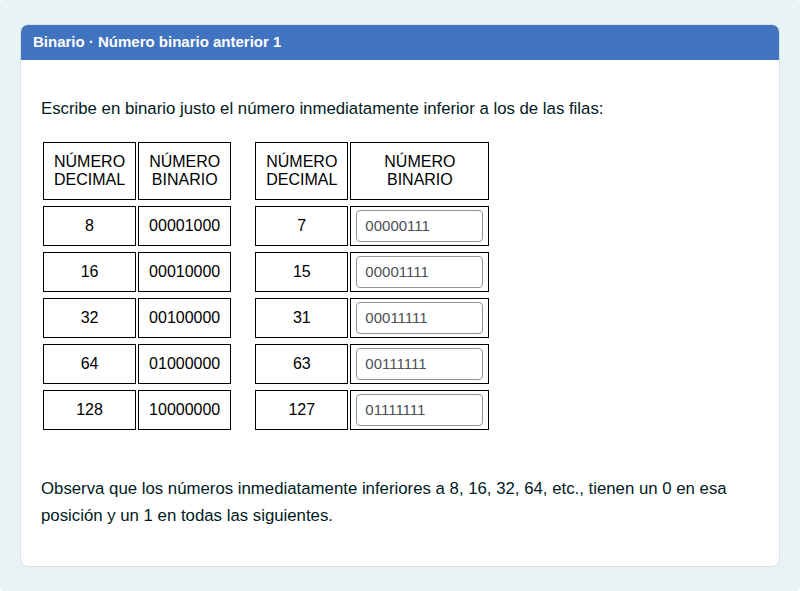

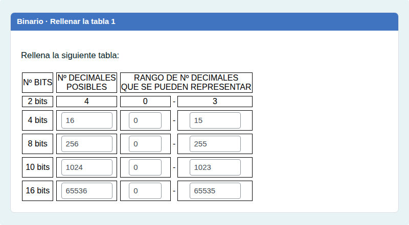

