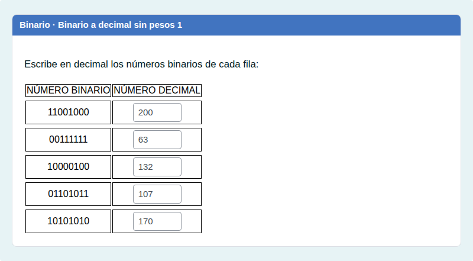
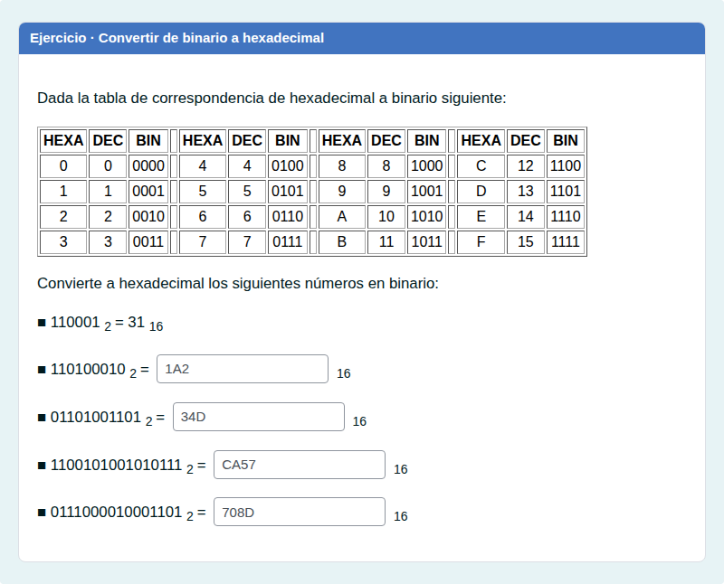
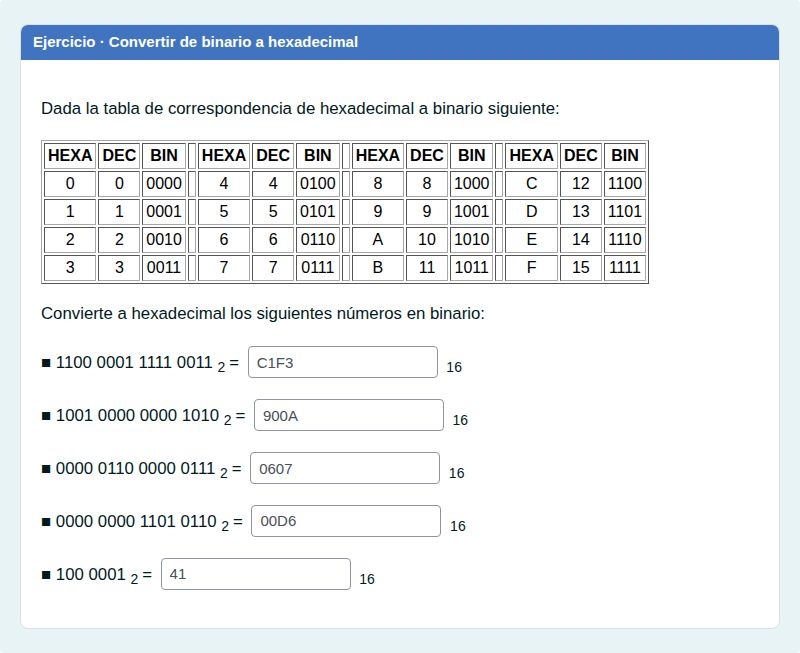
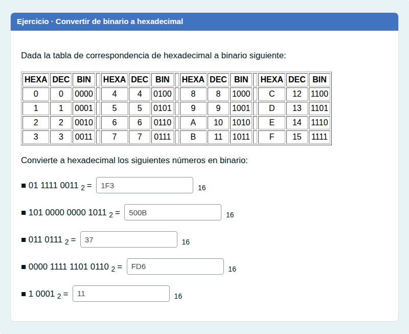
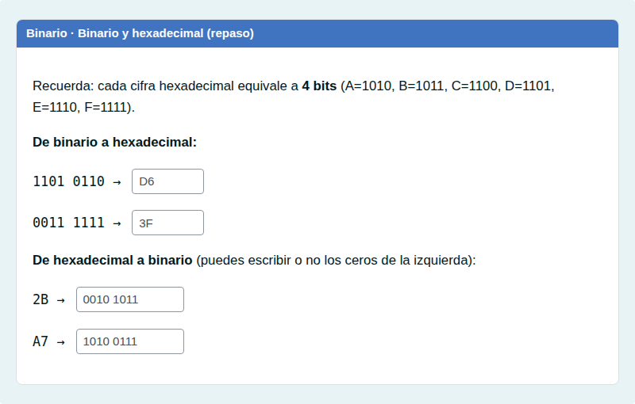
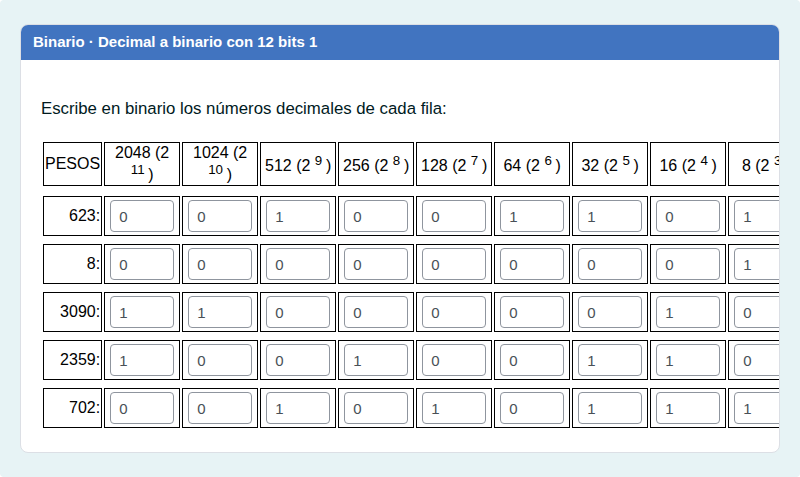
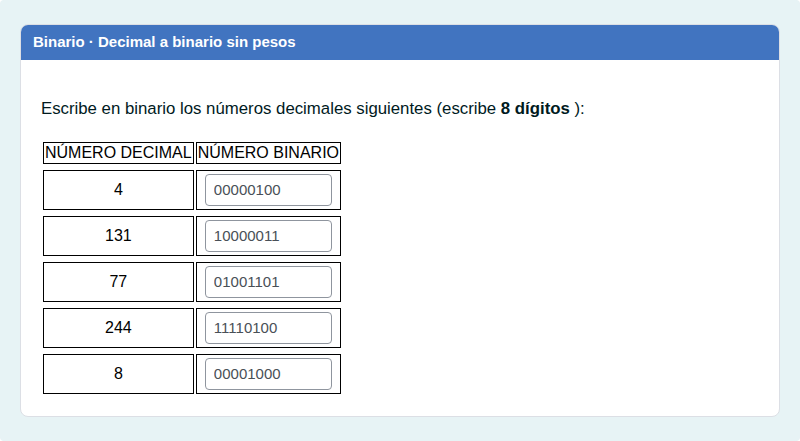
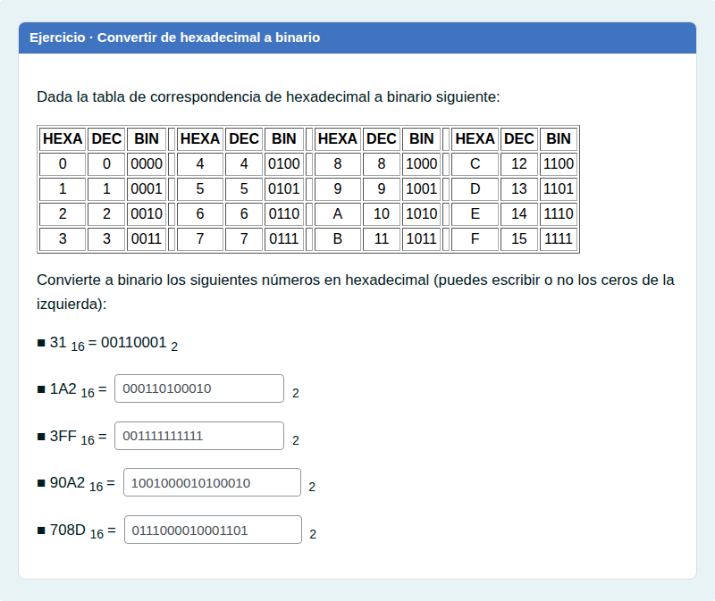
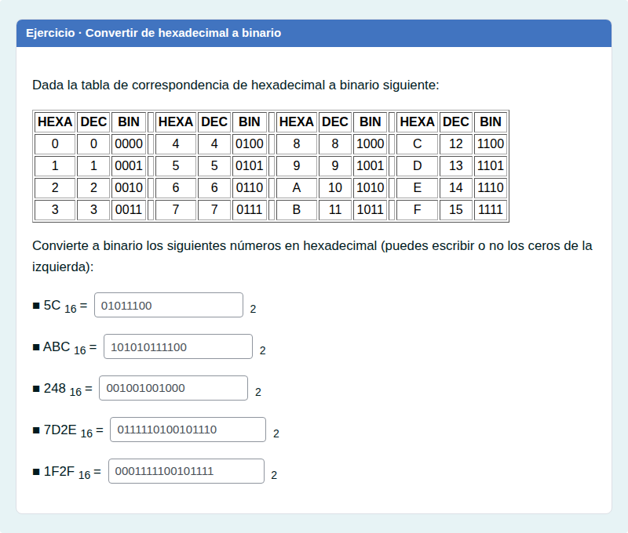
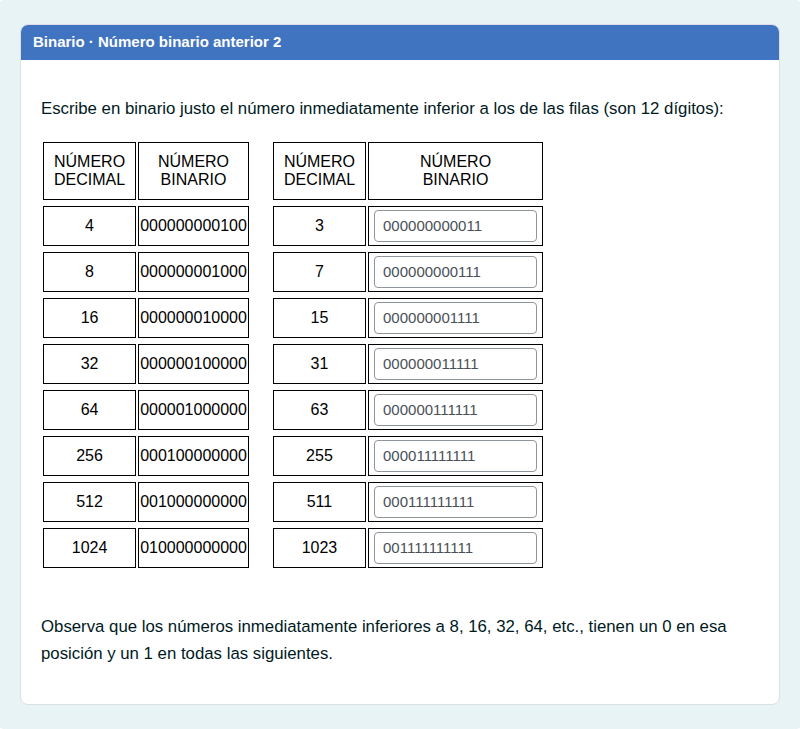

# Binario y hexadecimal sin ayuda

Conversiones entre decimal, binario y hexadecimal sin tabla de pesos, también con 12 bits.

## Contenido

Ficheros de preguntas disponibles en esta actividad:

### [binario-y-hexadecimal-sin-ayuda.xml](binario-y-hexadecimal-sin-ayuda.xml)

|   | Tipo              | Cantidad                   |
| - | ----------------- | -------------------------- |
|  | [Respuestas anidadas (Cloze)](#respuestas-anidadas-cloze) | 11 |
|   | **TOTAL**         | 11 |

#### Respuestas anidadas (Cloze)

