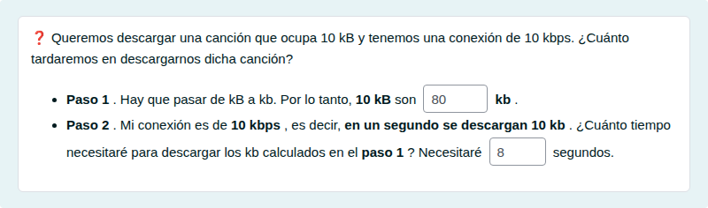
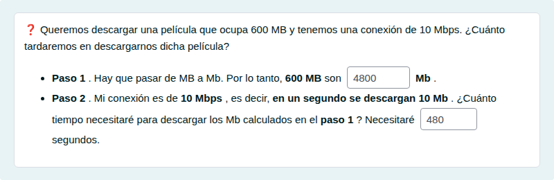

# Calcular el tiempo de descarga

Cálculo del tiempo de descarga de un archivo a partir de su tamaño y de la velocidad de la conexión.

## Contenido

Ficheros de preguntas disponibles en esta actividad:

### [calcular-el-tiempo-de-descarga.xml](calcular-el-tiempo-de-descarga.xml)

|   | Tipo              | Cantidad                   |
| - | ----------------- | -------------------------- |
|  | [Respuestas anidadas (Cloze)](#respuestas-anidadas-cloze) | 4 |
|  | [Selección múltiple](#selección-múltiple) | 4 |
|   | **TOTAL**         | 8 |

#### Respuestas anidadas (Cloze)

#### Selección múltiple

