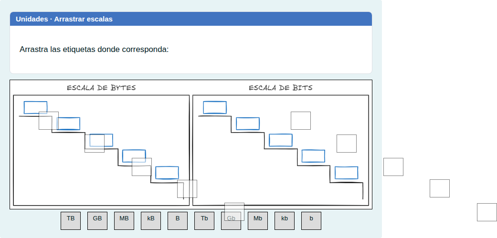
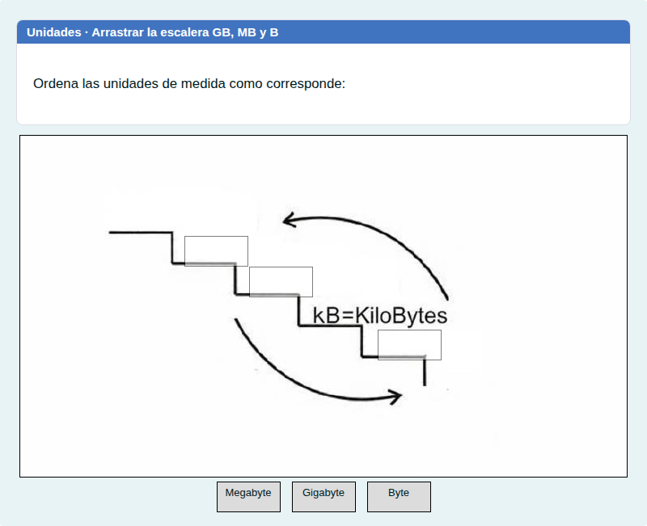
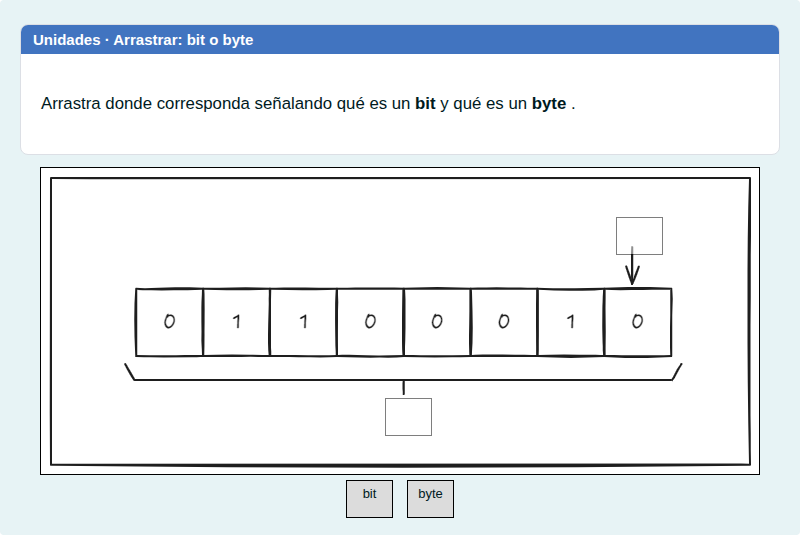
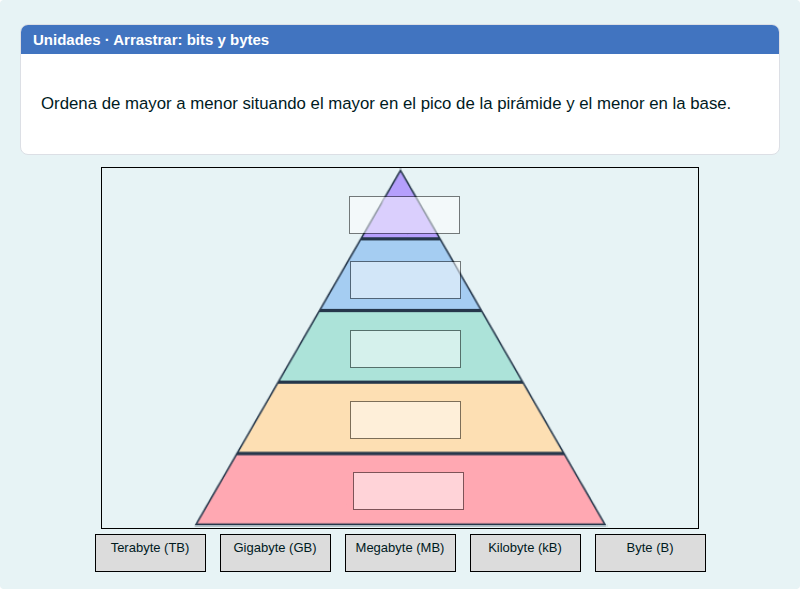
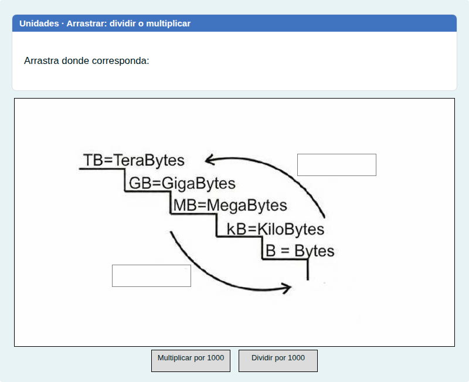
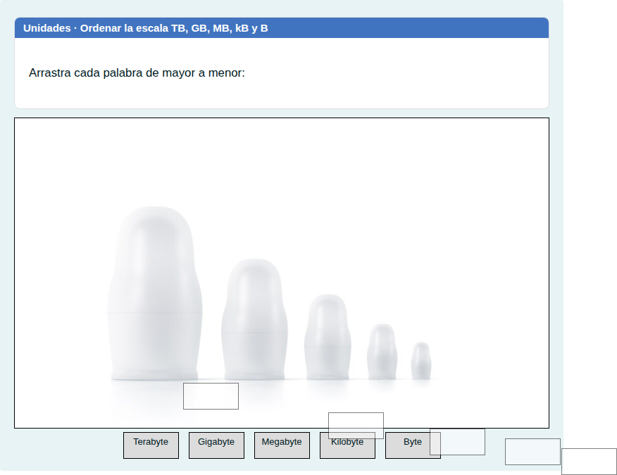
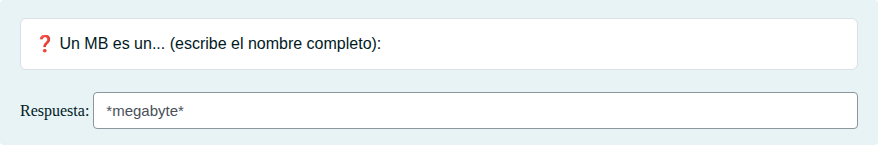
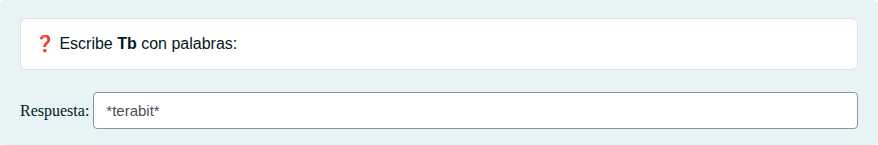
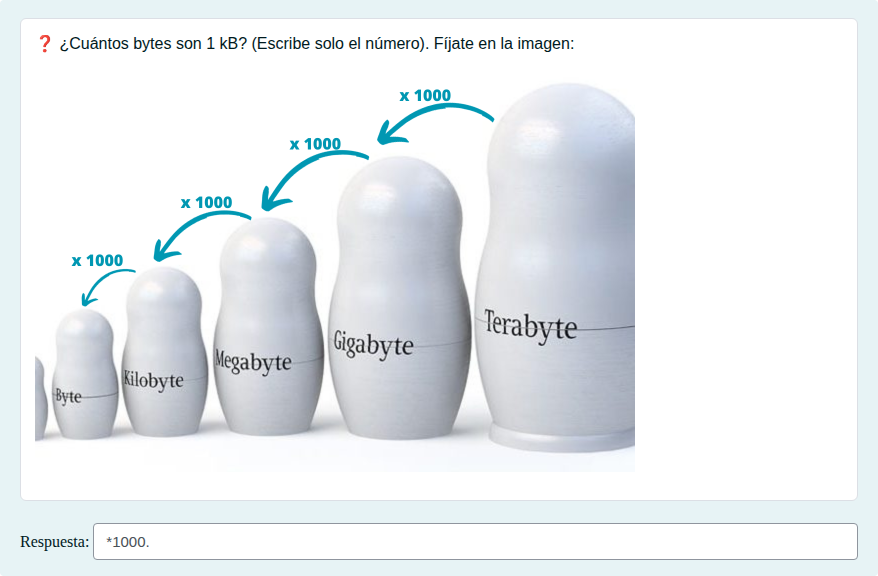

# Unidades de información: convertir y escribir

Conversiones entre bits, bytes y sus múltiplos decimales, y escritura de los nombres de las unidades.

## Contenido

Ficheros de preguntas disponibles en esta actividad:

### [unidades-de-informacion-convertir-y-escribir.xml](unidades-de-informacion-convertir-y-escribir.xml)

|   | Tipo              | Cantidad                   |
| - | ----------------- | -------------------------- |
|  | [Arrastrar y soltar imagen o texto](#arrastrar-y-soltar-imagen-o-texto) | 6 |
|  | [Respuesta corta](#respuesta-corta) | 5 |
|   | **TOTAL**         | 11 |

#### Arrastrar y soltar imagen o texto

#### Respuesta corta

