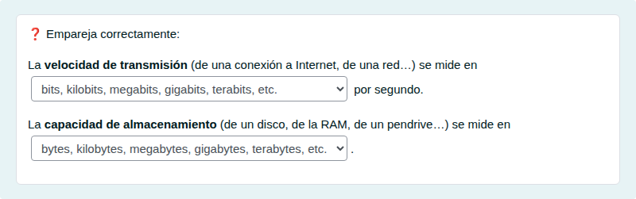

# Unidades de información: elegir

Bits y bytes, abreviaturas y unidades de capacidad y de velocidad, eligiendo la opción correcta.

## Contenido

Ficheros de preguntas disponibles en esta actividad:

### [unidades-de-informacion-elegir.xml](unidades-de-informacion-elegir.xml)

|   | Tipo              | Cantidad                   |
| - | ----------------- | -------------------------- |
|  | [Selección múltiple](#selección-múltiple) | 1 |
|  | [Respuestas anidadas (Cloze)](#respuestas-anidadas-cloze) | 2 |
|  | [Seleccionar palabras faltantes](#seleccionar-palabras-faltantes) | 1 |
|  | [Ordenación](#ordenación) | 1 |
|  | [Emparejamiento](#emparejamiento) | 2 |
|   | **TOTAL**         | 7 |

#### Selección múltiple

#### Respuestas anidadas (Cloze)

#### Seleccionar palabras faltantes

#### Ordenación

#### Emparejamiento

