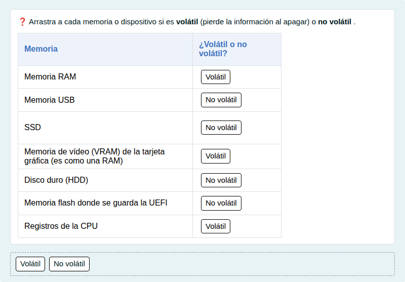

# Memoria RAM y memoria secundaria

Memoria volátil y no volátil, y diferencias entre la RAM y un SSD.

## Contenido

Ficheros de preguntas disponibles en esta actividad:

### [memoria-ram-y-memoria-secundaria.xml](memoria-ram-y-memoria-secundaria.xml)

|   | Tipo              | Cantidad                   |
| - | ----------------- | -------------------------- |
|  | [Respuesta corta](#respuesta-corta) | 1 |
|  | [Arrastrar y soltar marcador](#arrastrar-y-soltar-marcador) | 1 |
|  | [Arrastrar y soltar sobre texto](#arrastrar-y-soltar-sobre-texto) | 1 |
|   | **TOTAL**         | 3 |

#### Respuesta corta

#### Arrastrar y soltar marcador

#### Arrastrar y soltar sobre texto

