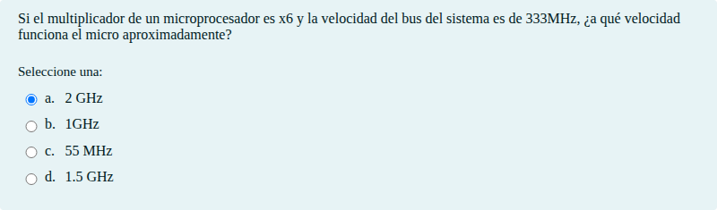
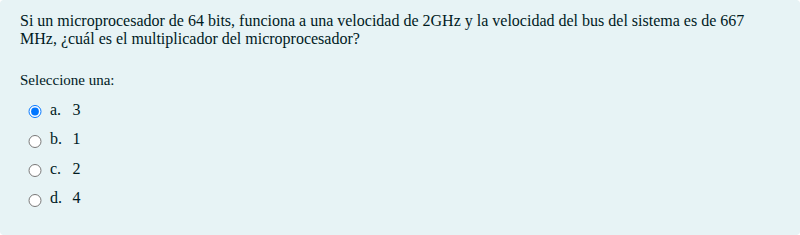
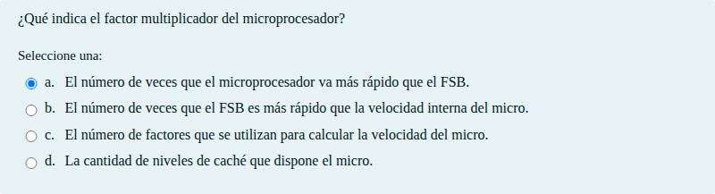
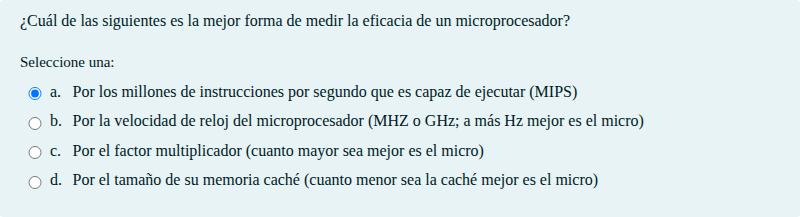
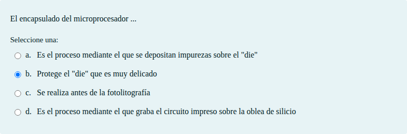
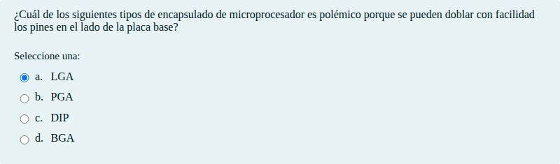
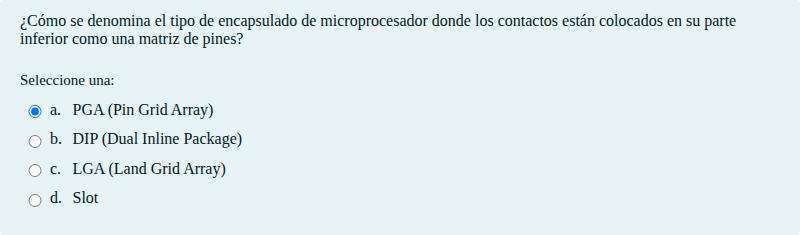
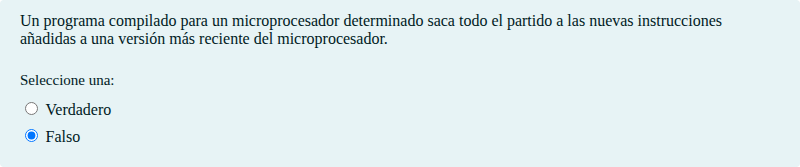
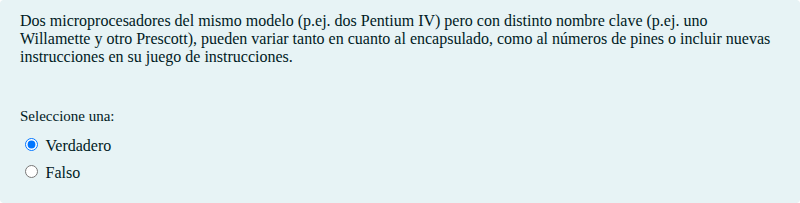

# El microprocesador

Preguntas tipo test, de asociación y de respuesta corta sobre el microprocesador

## Contenido

Ficheros de preguntas disponibles en esta actividad:

### [questions.xml](questions.xml)

|   | Tipo              | Cantidad                   |
| - | ----------------- | -------------------------- |
|  | [Selección múltiple](#selección-múltiple) | 70 |
|  | [Verdadero/Falso](#verdaderofalso) | 8 |
|  | [Respuesta corta](#respuesta-corta) | 3 |
|   | **TOTAL**         | 81 |

#### Selección múltiple

#### Verdadero/Falso

#### Respuesta corta

