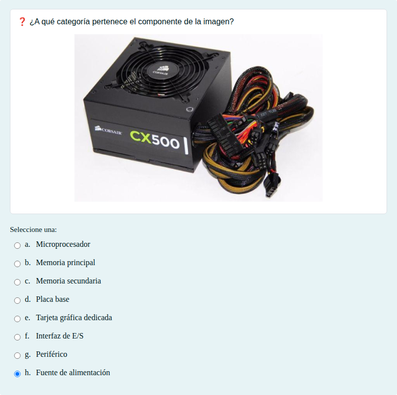
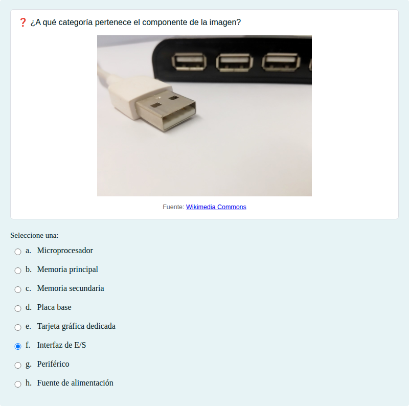
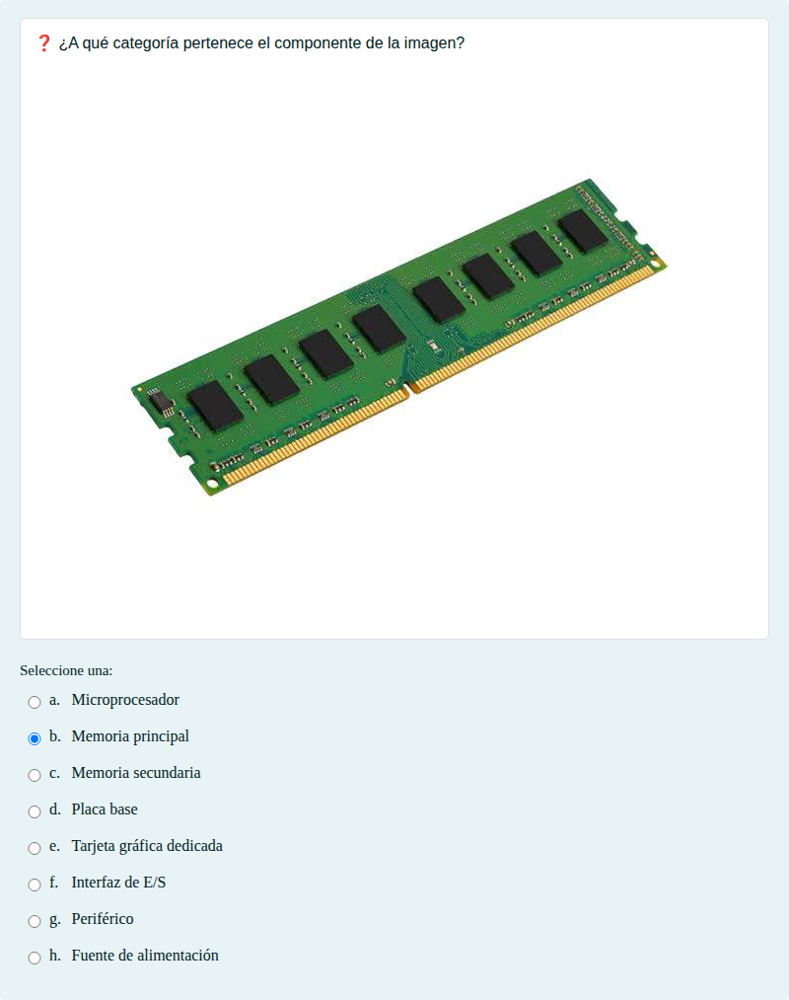
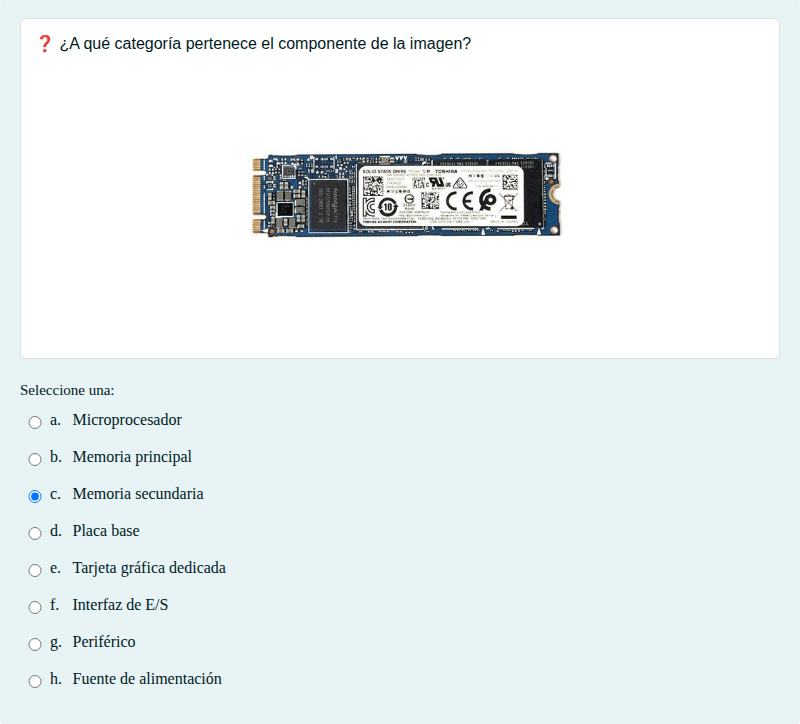
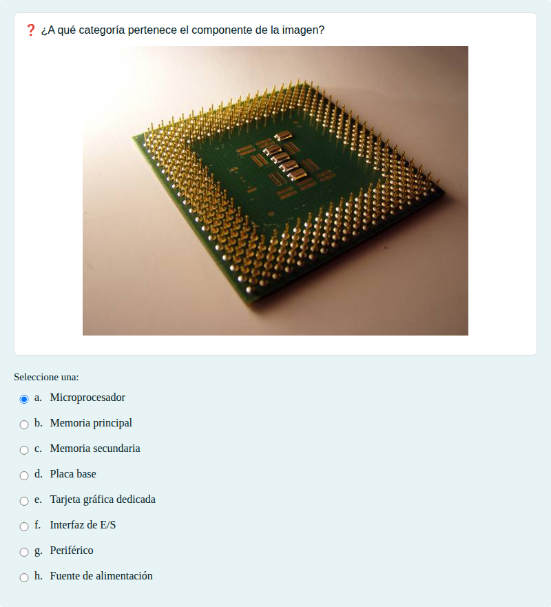

# Componentes del ordenador: elegir

Reconocer en una foto a qué categoría pertenece un componente y clasificar periféricos de entrada y salida.

## Contenido

Ficheros de preguntas disponibles en esta actividad:

### [componentes-del-ordenador-elegir.xml](componentes-del-ordenador-elegir.xml)

|   | Tipo              | Cantidad                   |
| - | ----------------- | -------------------------- |
|  | [Selección múltiple](#selección-múltiple) | 8 |
|   | **TOTAL**         | 8 |

#### Selección múltiple

