# Componentes y periféricos: escribir el nombre

Escribir el nombre de componentes internos y periféricos a partir de una foto y una descripción.

## Contenido

Ficheros de preguntas disponibles en esta actividad:

### [componentes-y-perifericos-escribir-el-nombre.xml](componentes-y-perifericos-escribir-el-nombre.xml)

|   | Tipo              | Cantidad                   |
| - | ----------------- | -------------------------- |
|  | [Respuesta corta](#respuesta-corta) | 18 |
|   | **TOTAL**         | 18 |

#### Respuesta corta

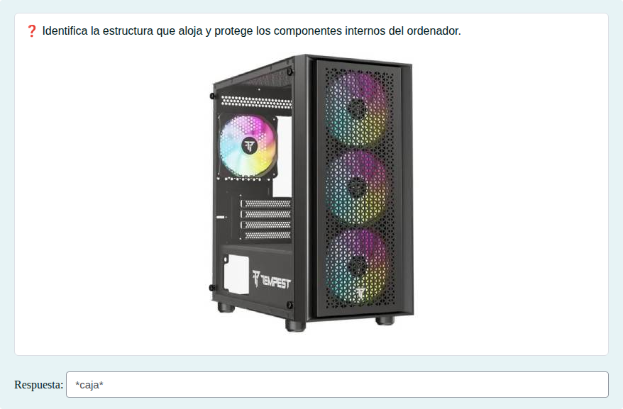

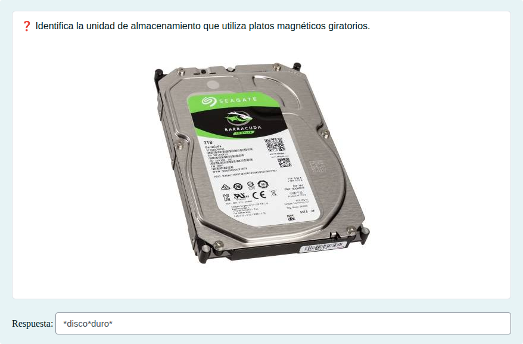

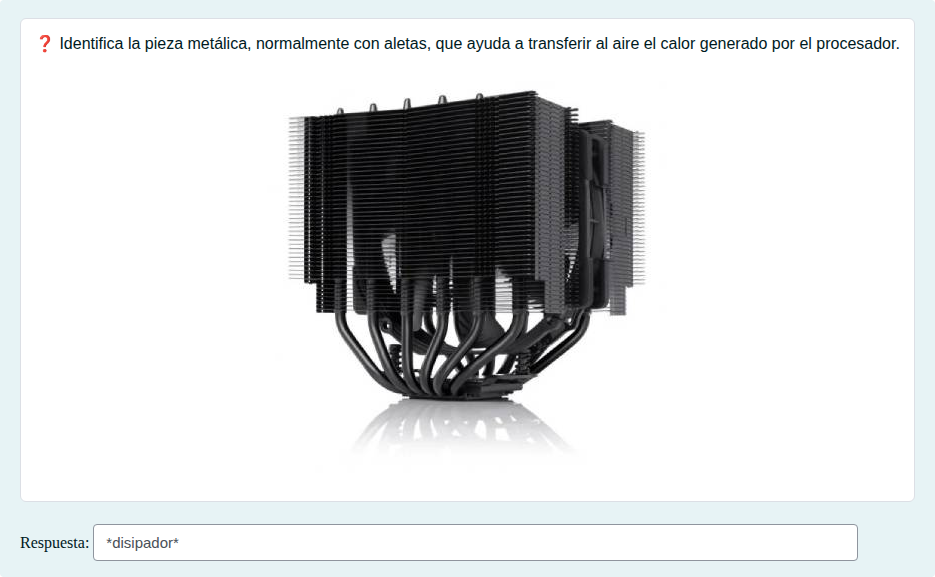

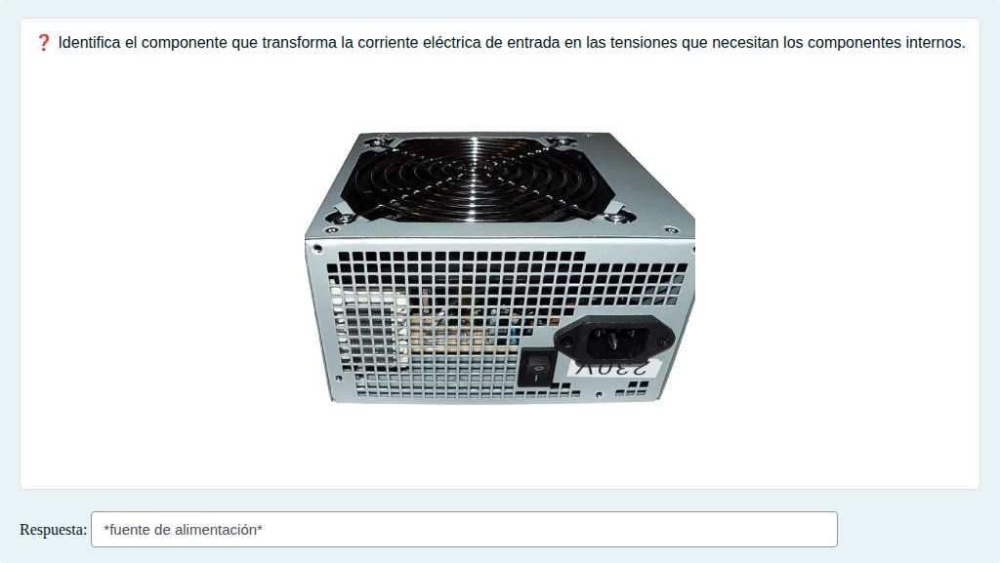

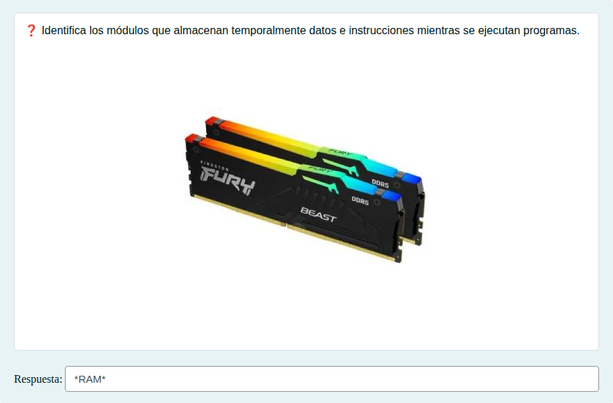

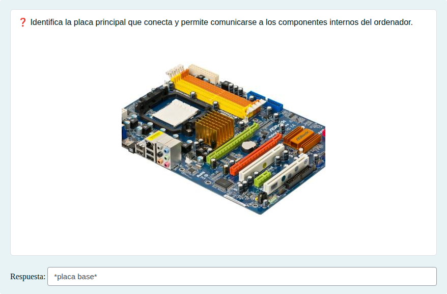

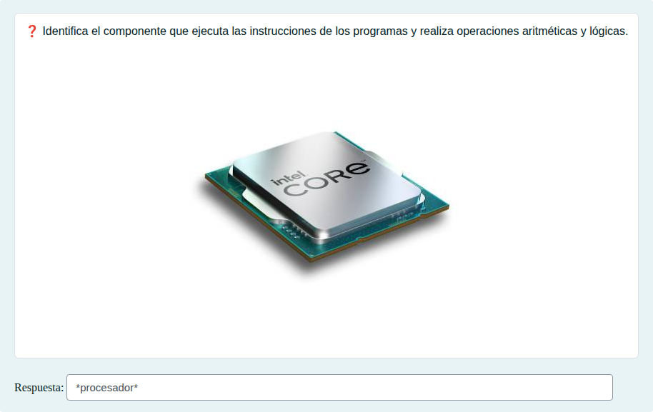

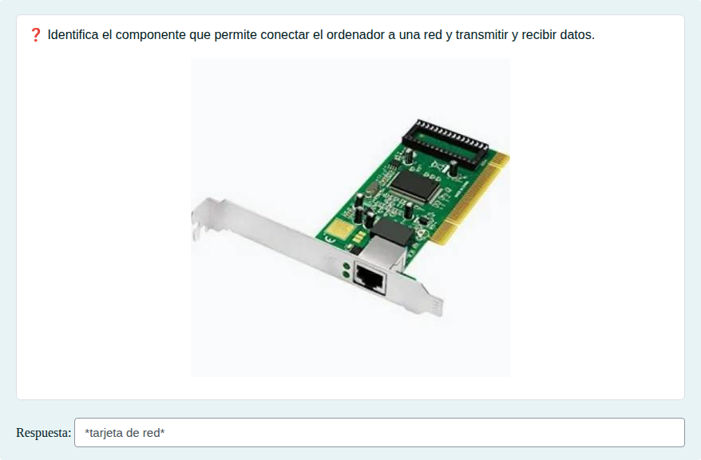

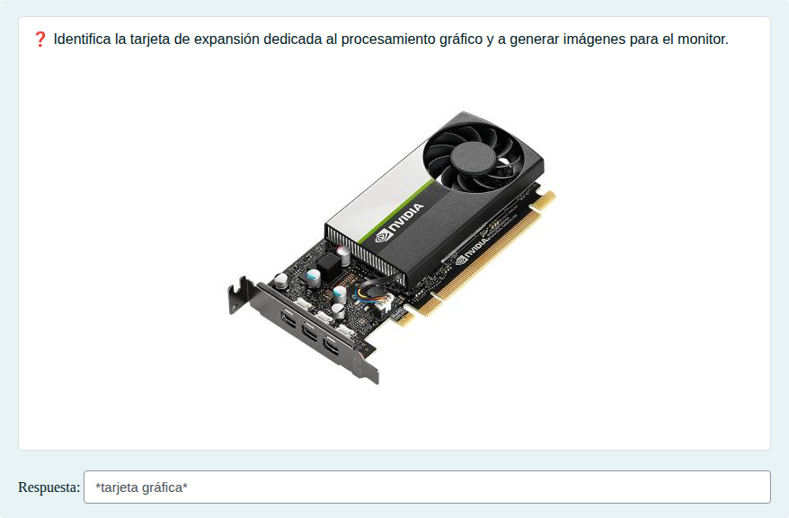

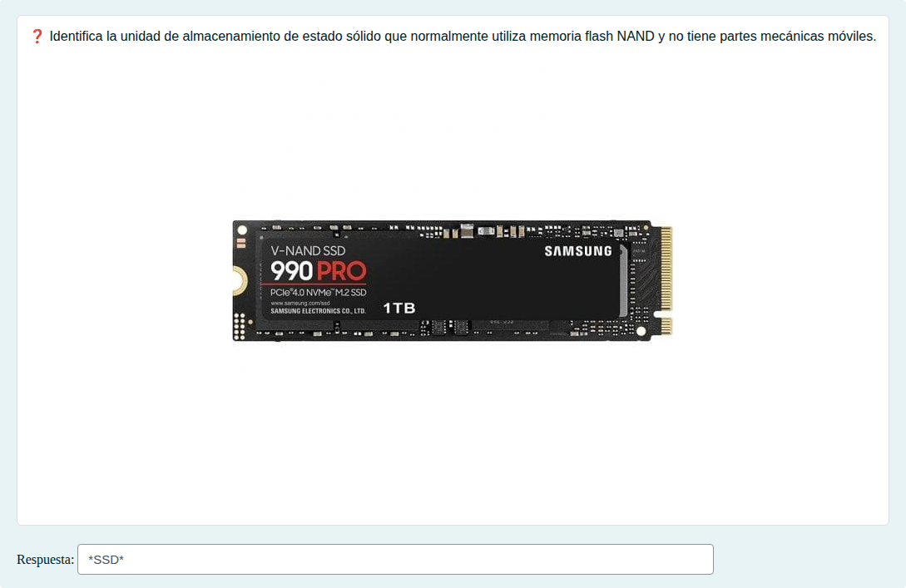

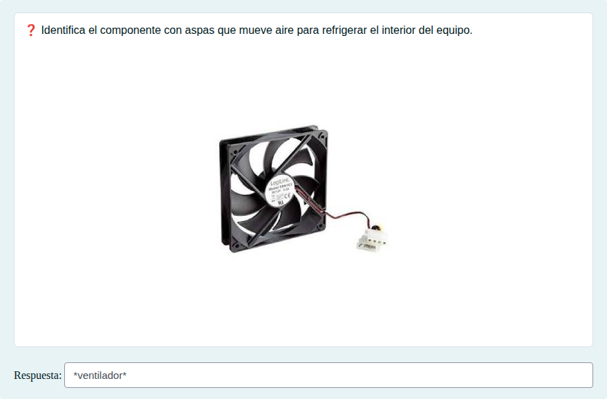

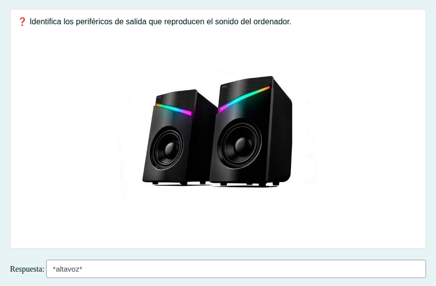

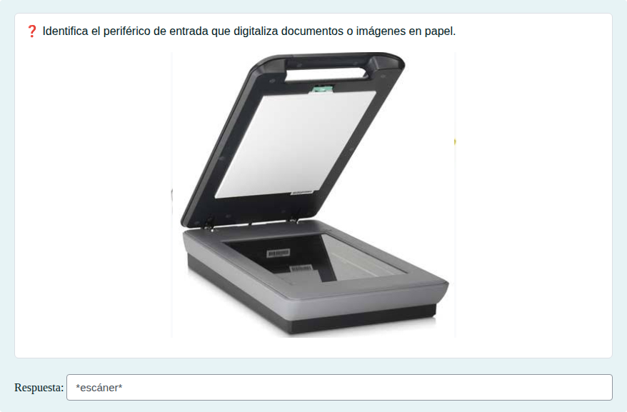

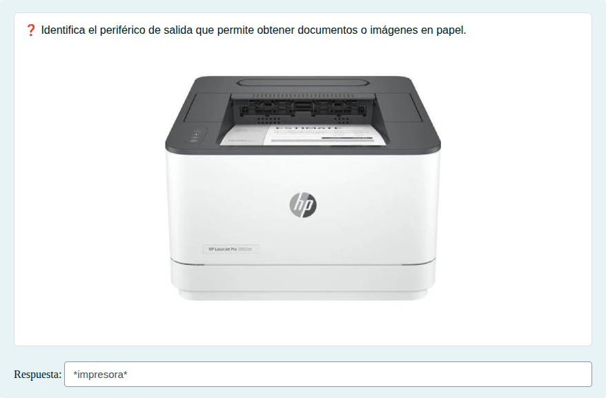

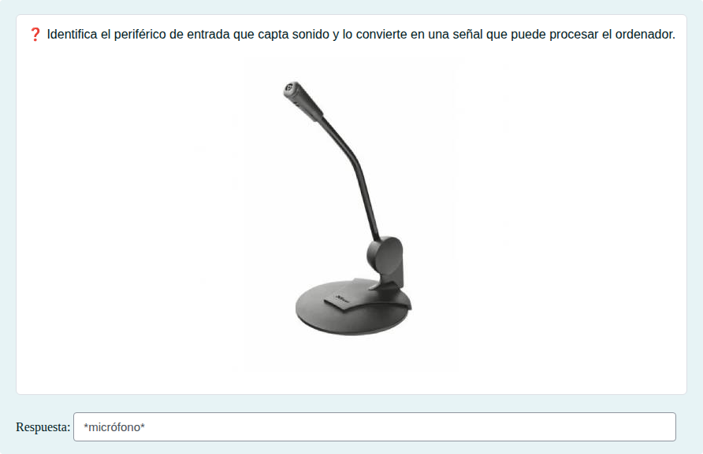

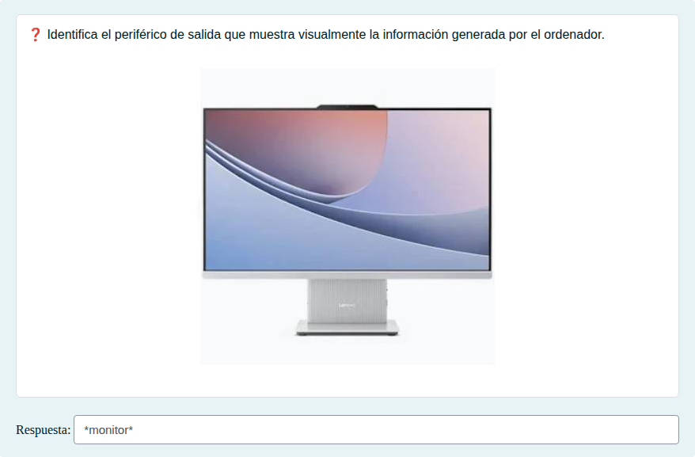

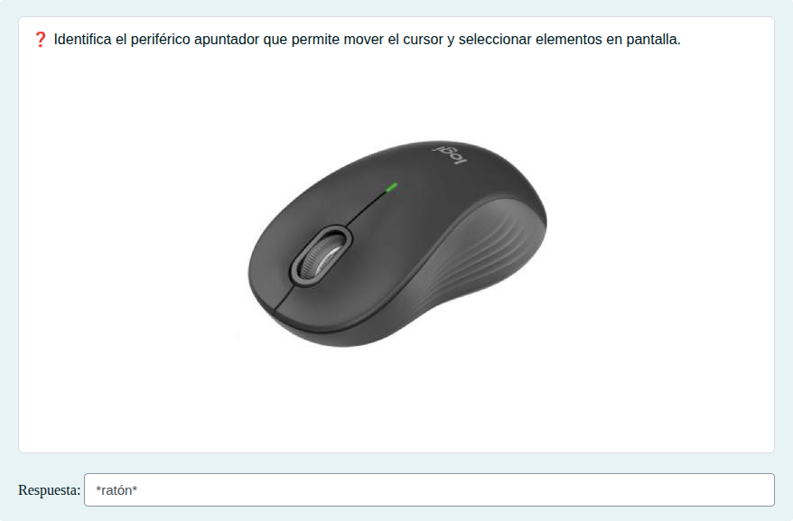

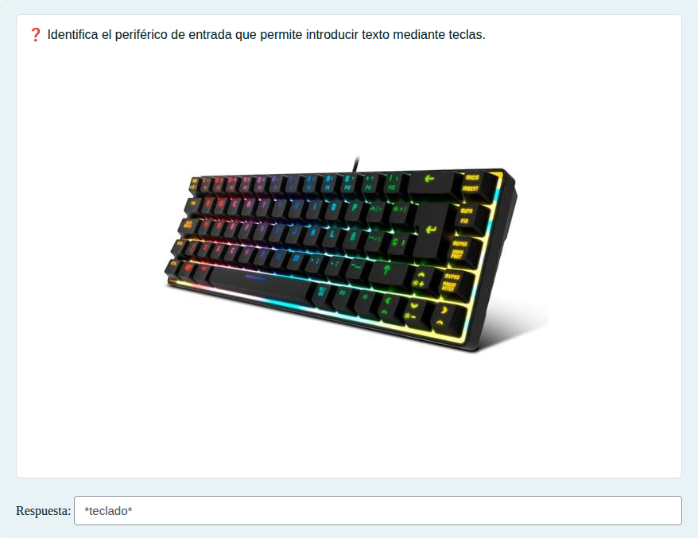

