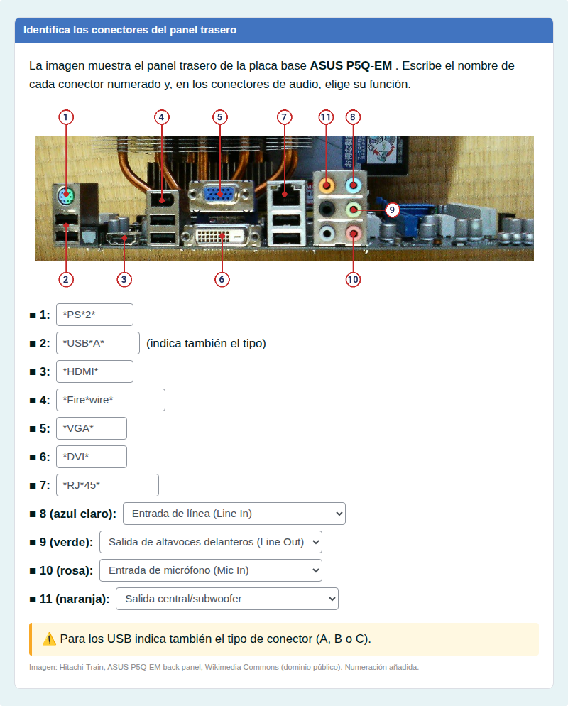
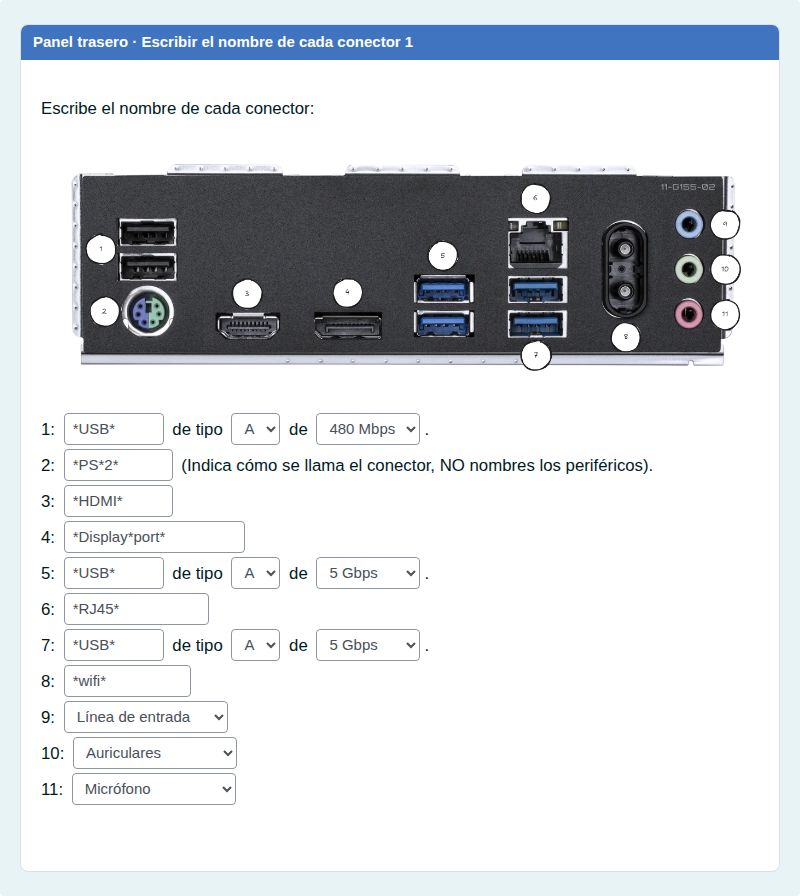
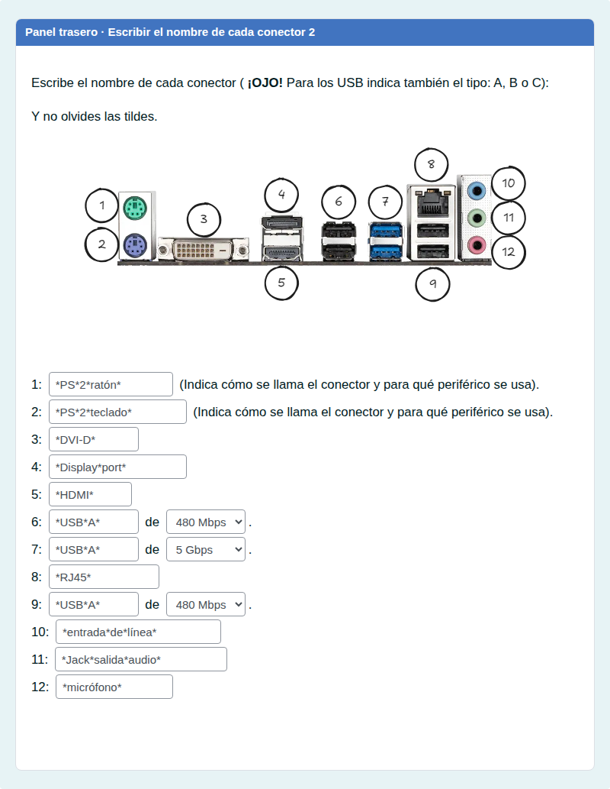
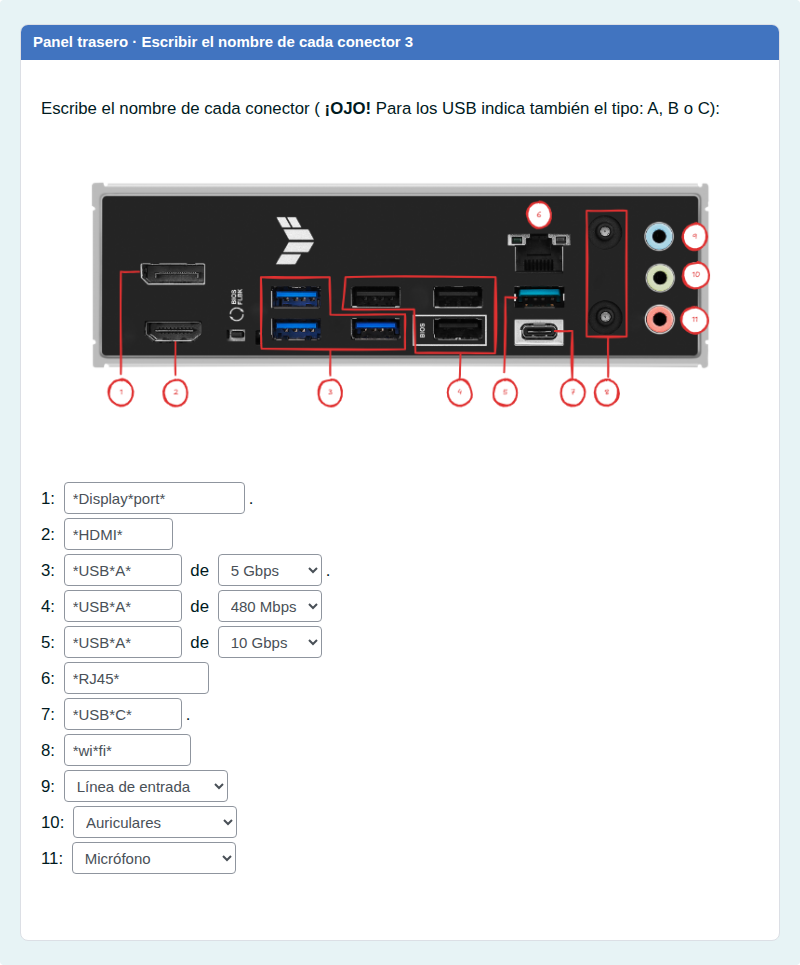
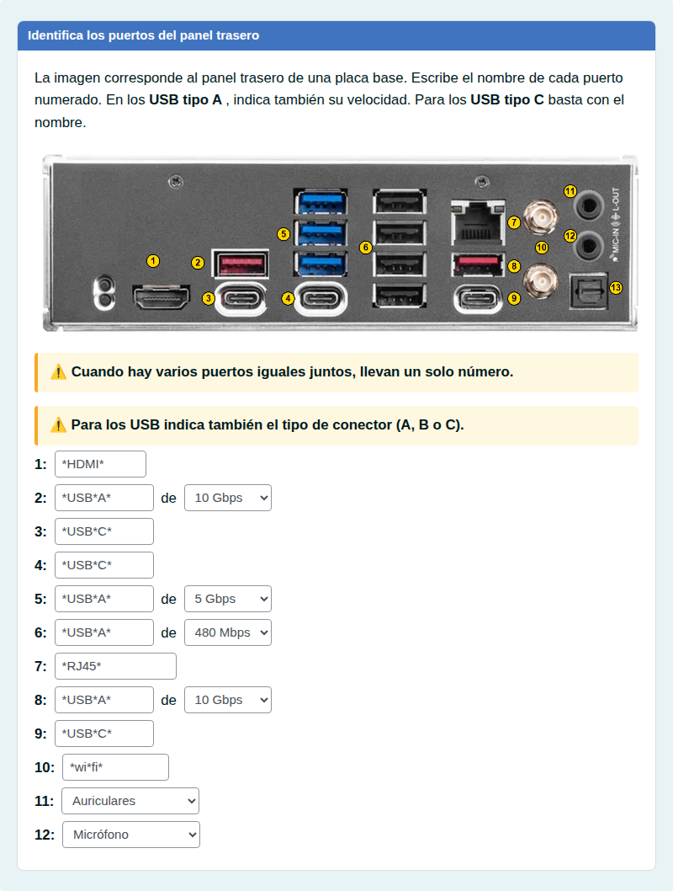

# Panel trasero: nombre y velocidad de cada puerto

Escribir el nombre de cada puerto de paneles traseros reales, con el tipo y la velocidad de los USB.

## Contenido

Ficheros de preguntas disponibles en esta actividad:

### [panel-trasero-nombre-y-velocidad-de-cada-puerto.xml](panel-trasero-nombre-y-velocidad-de-cada-puerto.xml)

|   | Tipo              | Cantidad                   |
| - | ----------------- | -------------------------- |
|  | [Respuestas anidadas (Cloze)](#respuestas-anidadas-cloze) | 5 |
|   | **TOTAL**         | 5 |

#### Respuestas anidadas (Cloze)

