# Puertos y cables: elegir

Reconocer puertos y cables de vídeo, USB, red y audio, y los jacks de un sistema 7.1.

## Contenido

Ficheros de preguntas disponibles en esta actividad:

### [puertos-y-cables-elegir.xml](puertos-y-cables-elegir.xml)

|   | Tipo              | Cantidad                   |
| - | ----------------- | -------------------------- |
|  | [Respuestas anidadas (Cloze)](#respuestas-anidadas-cloze) | 3 |
|  | [Emparejamiento](#emparejamiento) | 1 |
|  | [Selección múltiple](#selección-múltiple) | 15 |
|   | **TOTAL**         | 19 |

#### Respuestas anidadas (Cloze)

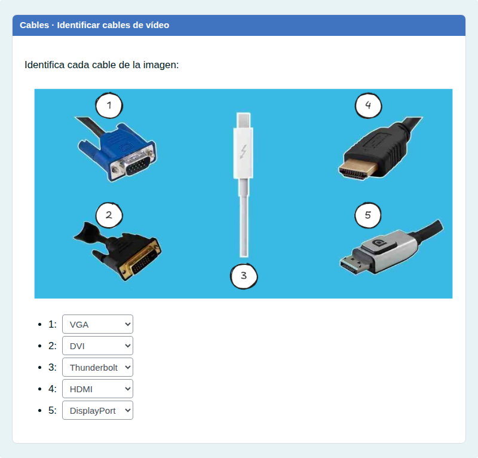

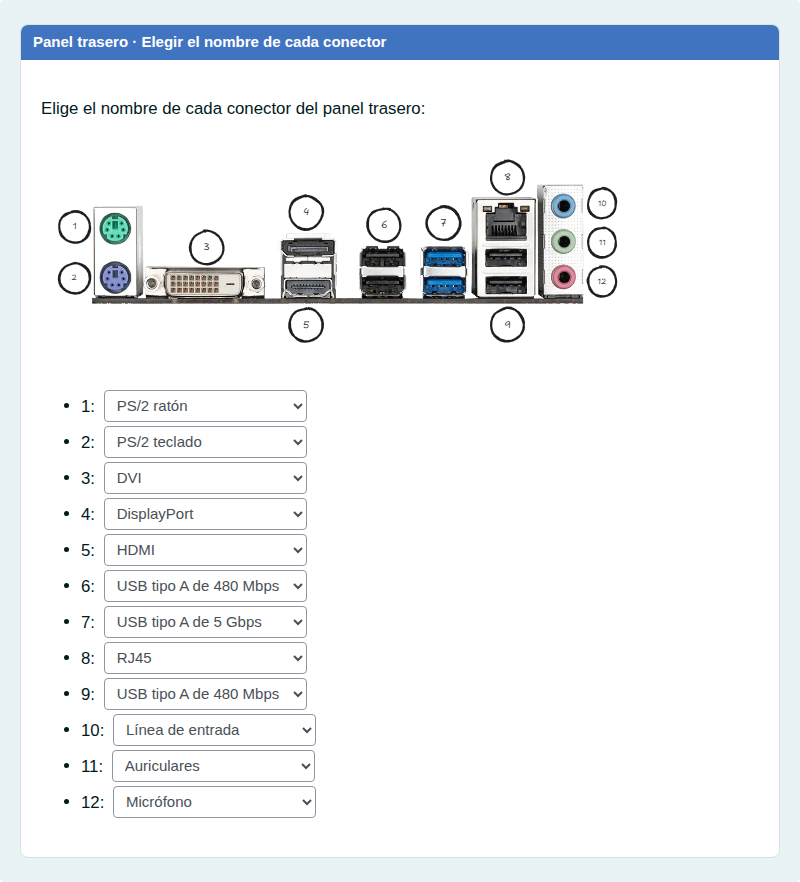

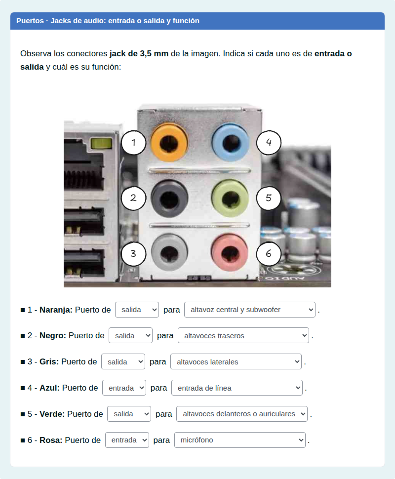

#### Emparejamiento

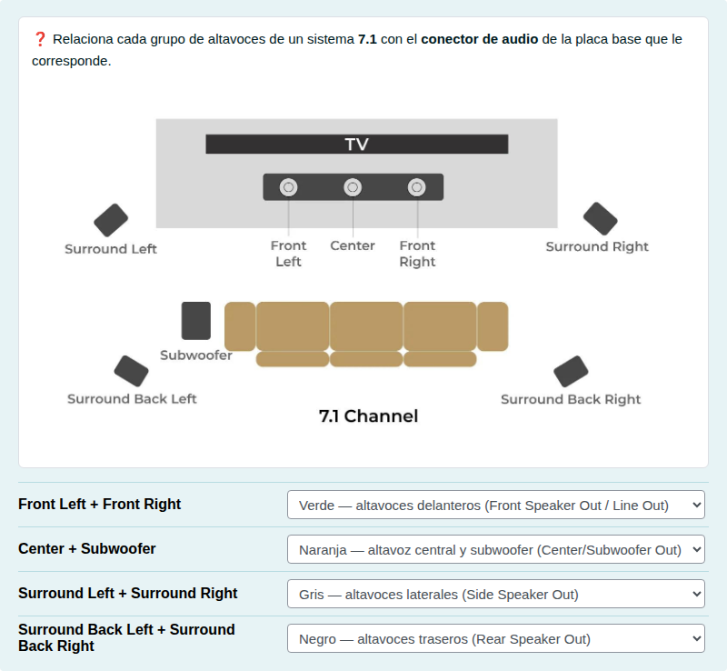

#### Selección múltiple

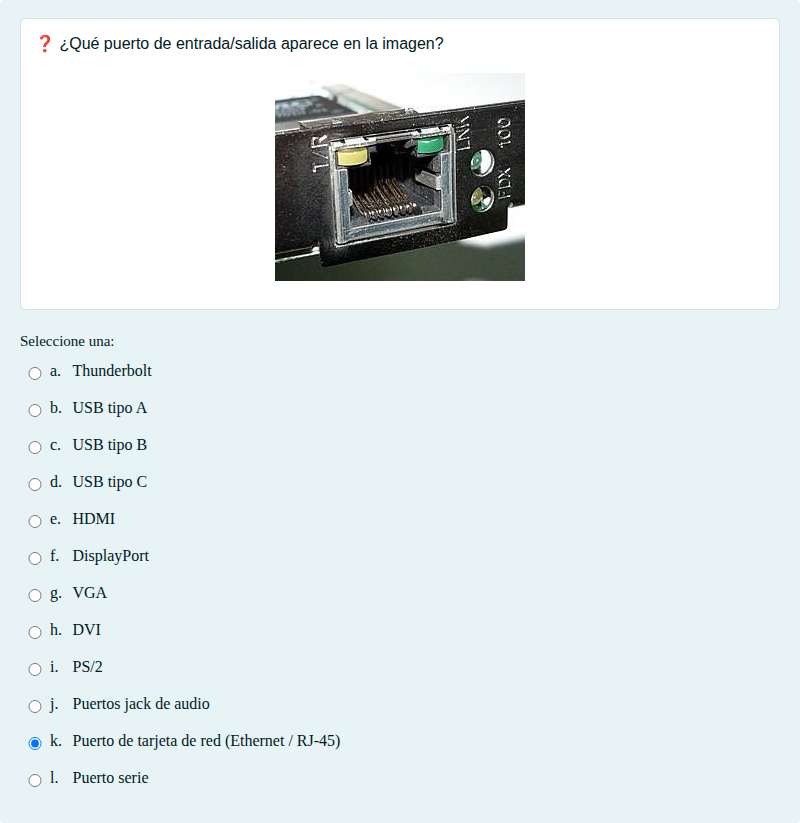

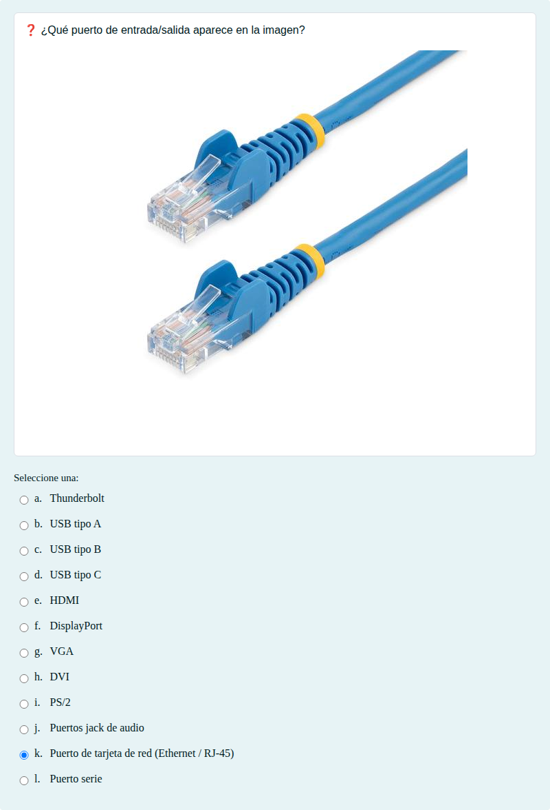

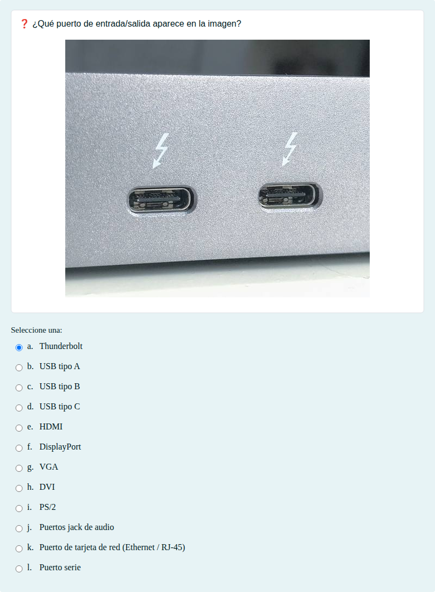

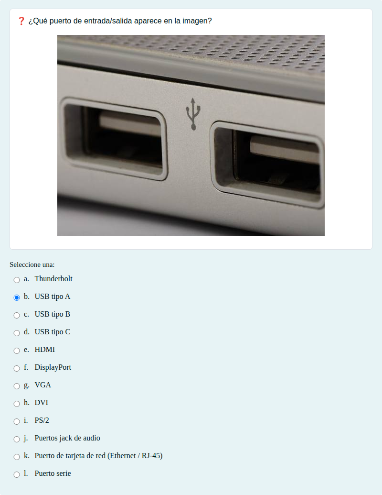

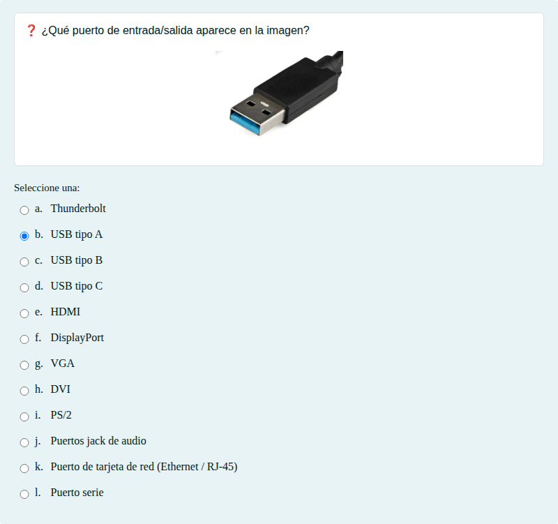

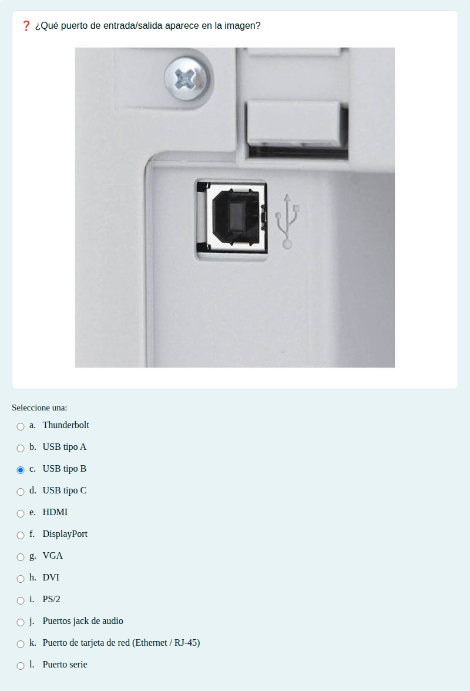

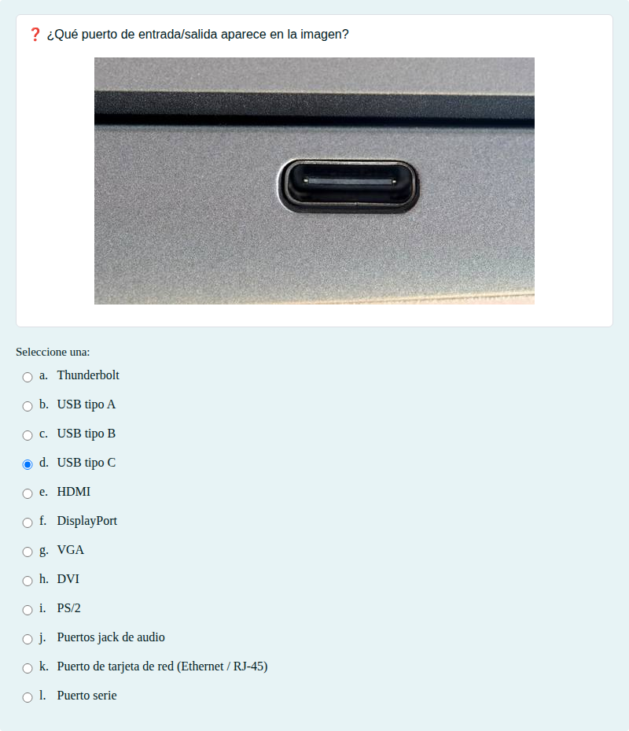

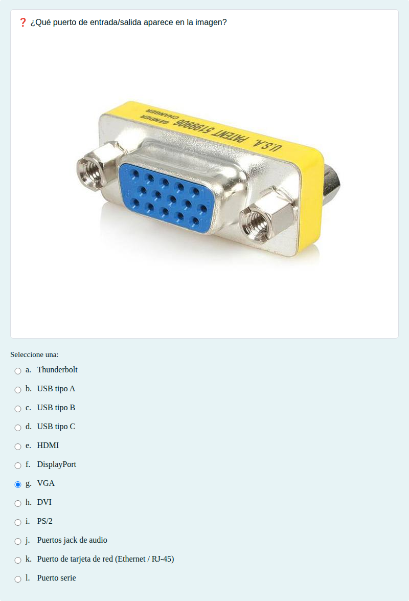

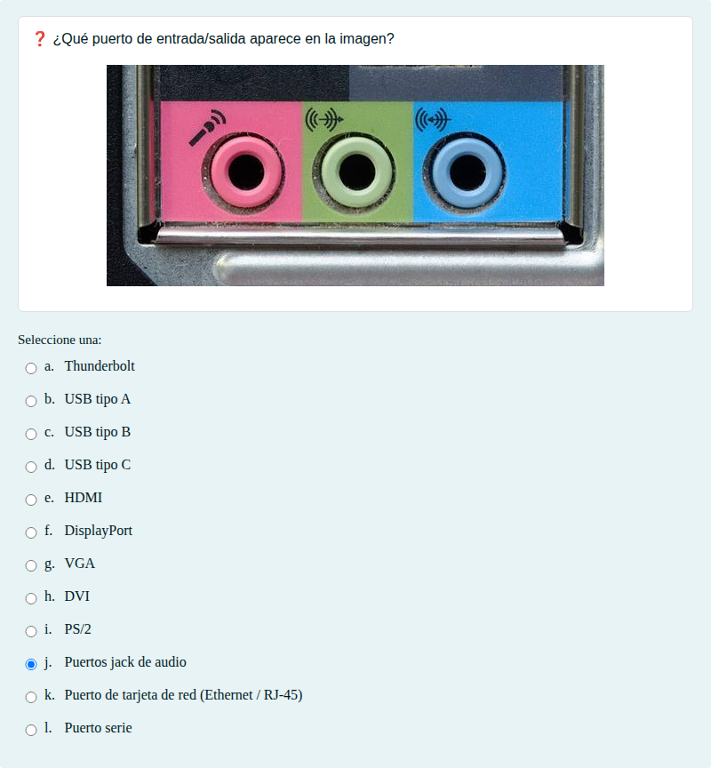

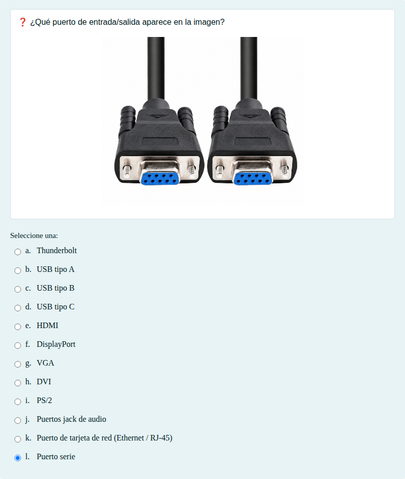

