# Puertos y cables: escribir el nombre

Escribir el nombre de puertos y cables a partir de una foto, y arrastrar etiquetas sobre paneles traseros.

## Contenido

Ficheros de preguntas disponibles en esta actividad:

### [puertos-y-cables-escribir-el-nombre.xml](puertos-y-cables-escribir-el-nombre.xml)

|   | Tipo              | Cantidad                   |
| - | ----------------- | -------------------------- |
|  | [Respuesta corta](#respuesta-corta) | 9 |
|  | [Respuestas anidadas (Cloze)](#respuestas-anidadas-cloze) | 3 |
|  | [Arrastrar y soltar imagen o texto](#arrastrar-y-soltar-imagen-o-texto) | 2 |
|  | [Arrastrar y soltar marcador](#arrastrar-y-soltar-marcador) | 1 |
|   | **TOTAL**         | 15 |

#### Respuesta corta

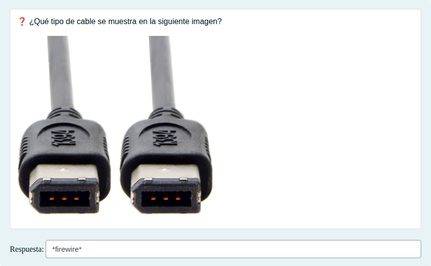

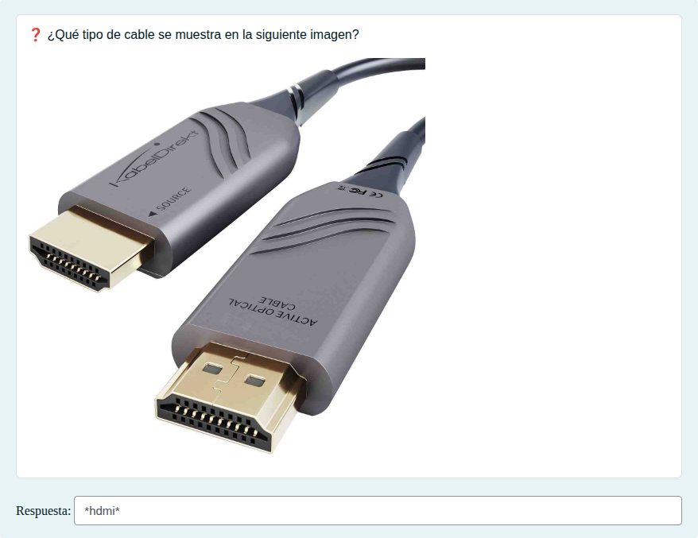

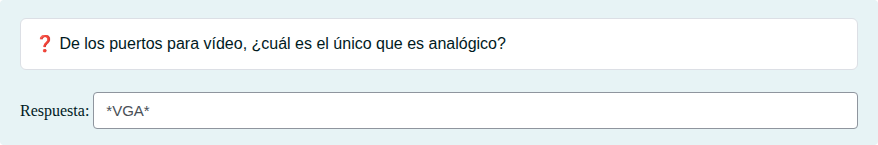

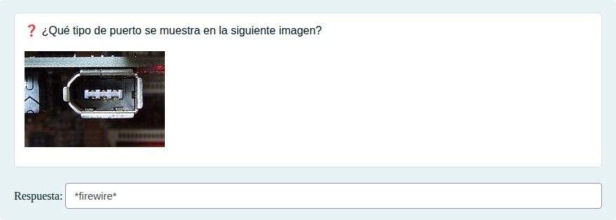

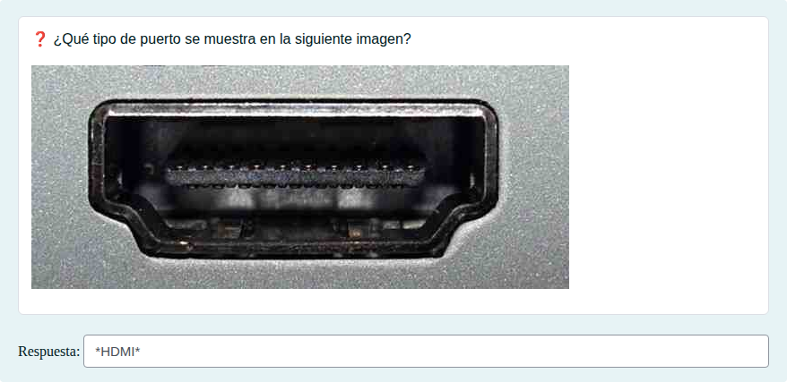

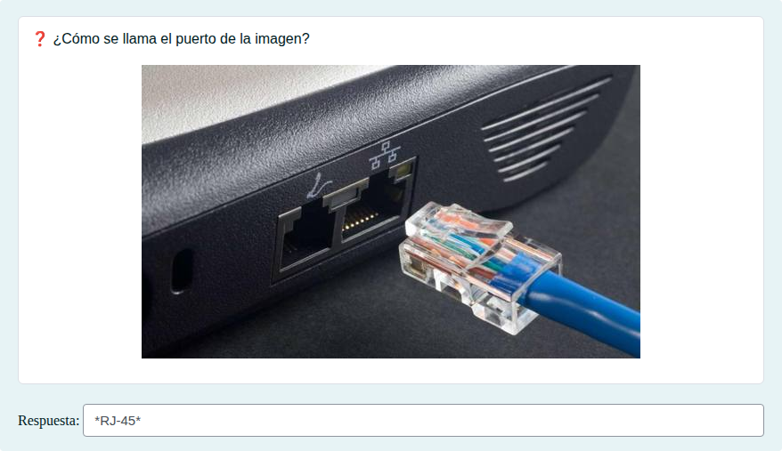

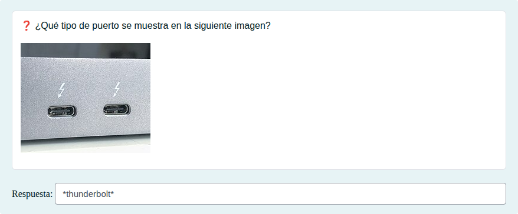

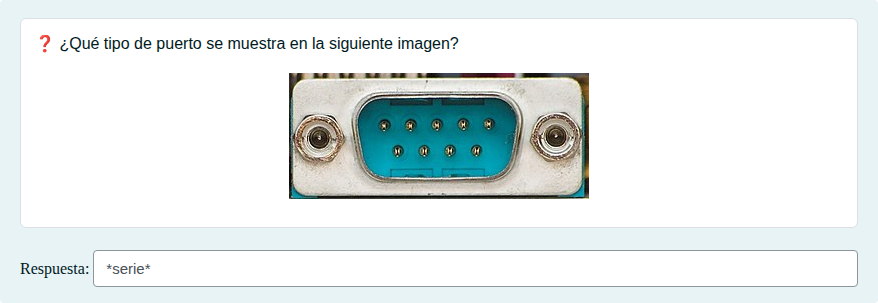

#### Respuestas anidadas (Cloze)

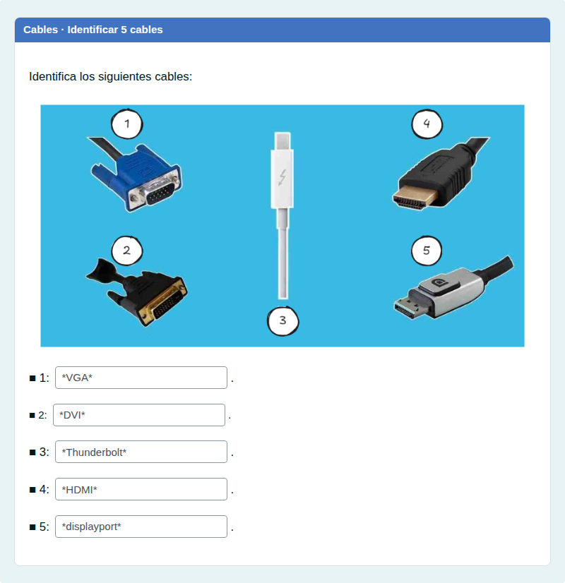

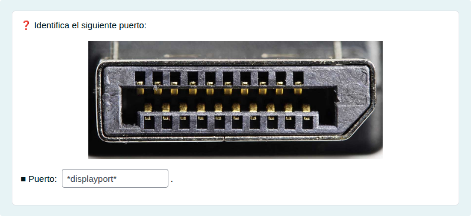

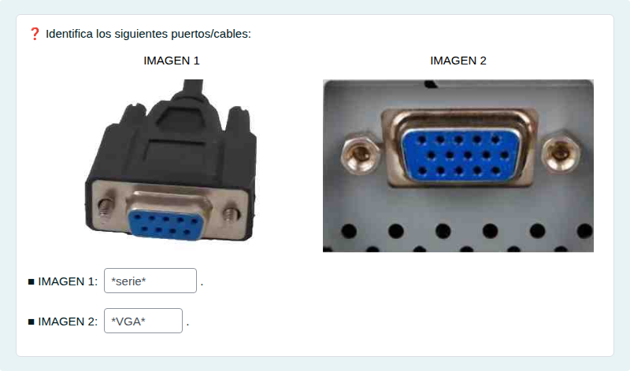

#### Arrastrar y soltar imagen o texto

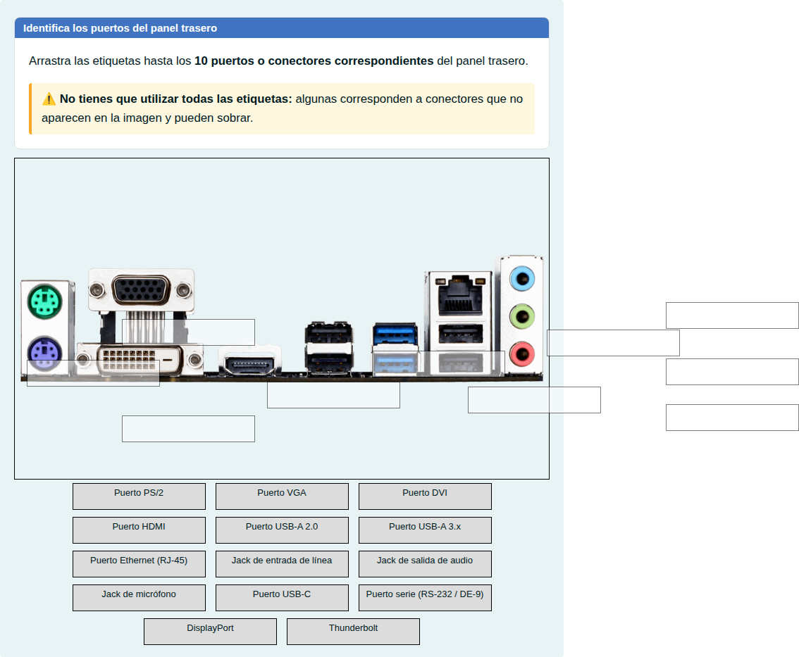

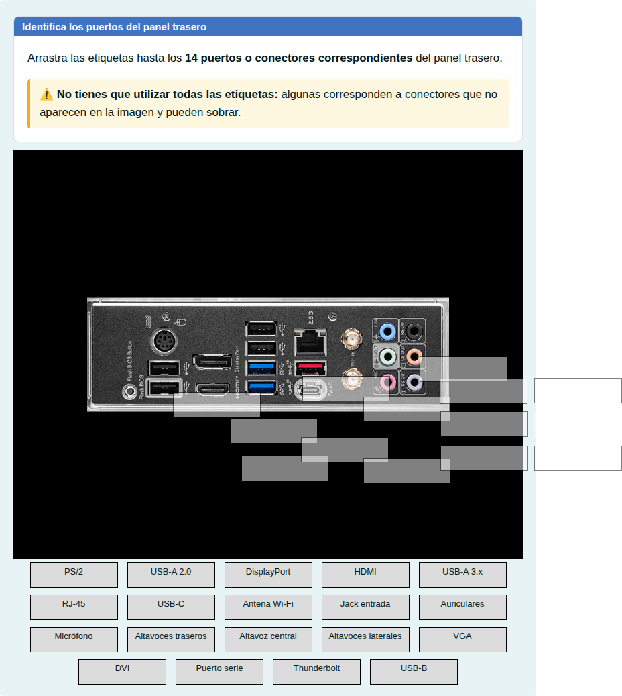

#### Arrastrar y soltar marcador

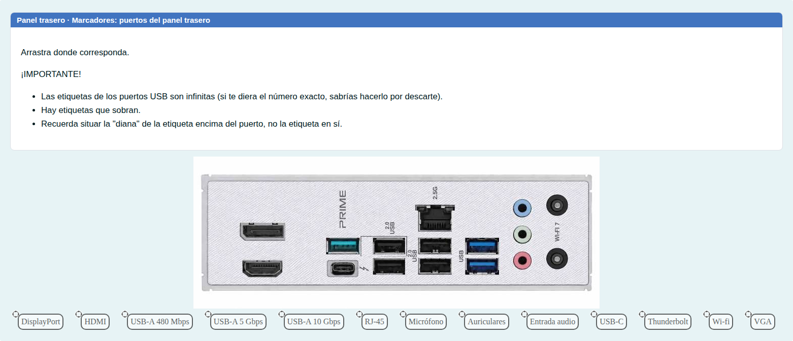

