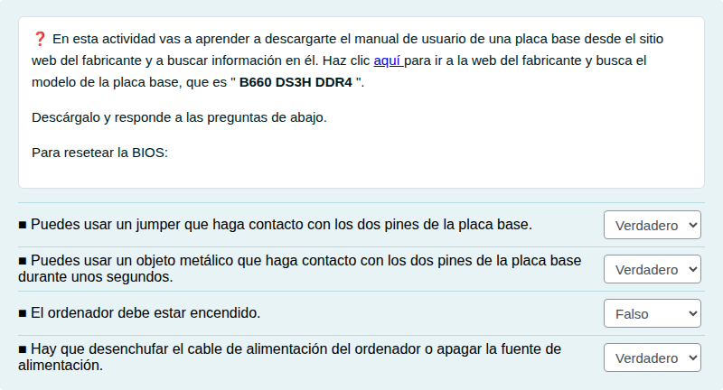
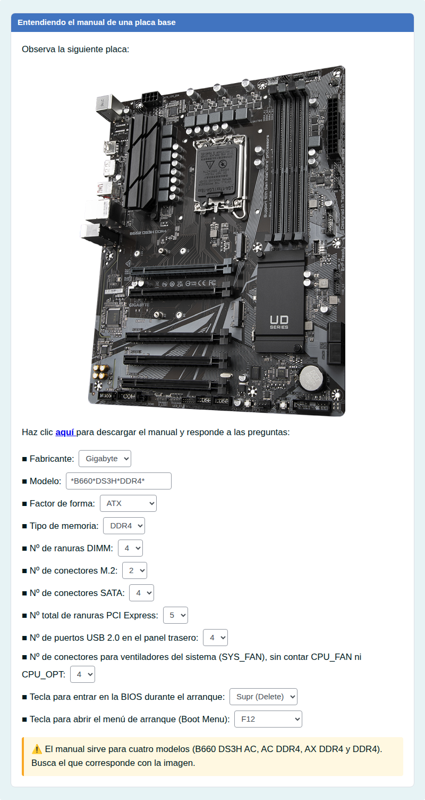
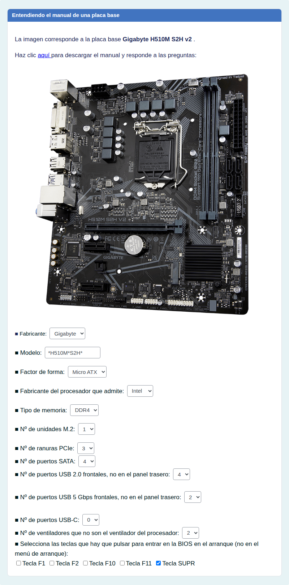
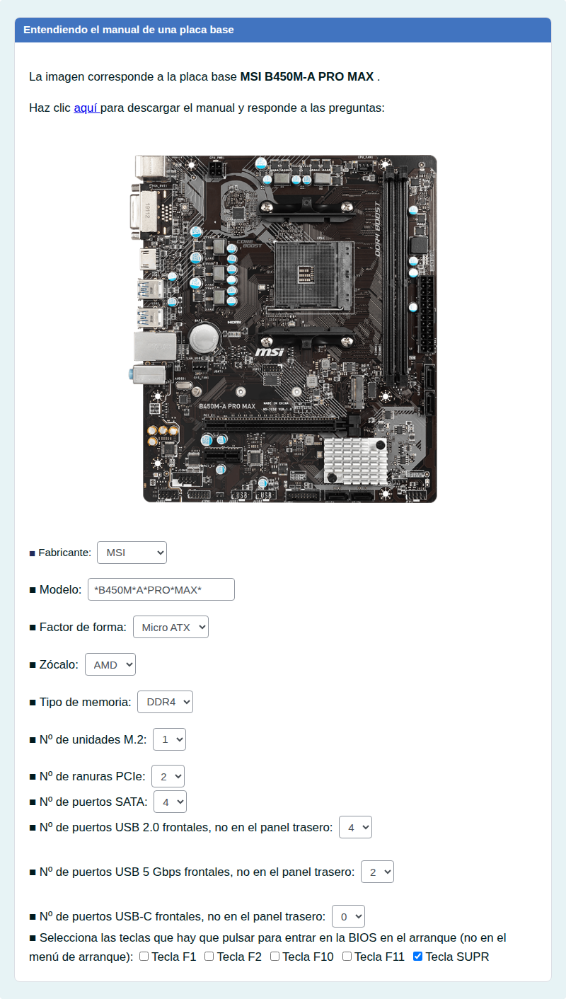

# Buscar datos en el manual de la placa base

Buscar en el manual del fabricante las características de una placa base: memoria, ranuras, conectores y teclas de la UEFI.

## Contenido

Ficheros de preguntas disponibles en esta actividad:

### [buscar-datos-en-el-manual-de-la-placa-base.xml](buscar-datos-en-el-manual-de-la-placa-base.xml)

|   | Tipo              | Cantidad                   |
| - | ----------------- | -------------------------- |
|  | [Emparejamiento](#emparejamiento) | 1 |
|  | [Respuestas anidadas (Cloze)](#respuestas-anidadas-cloze) | 3 |
|   | **TOTAL**         | 4 |

#### Emparejamiento

#### Respuestas anidadas (Cloze)

