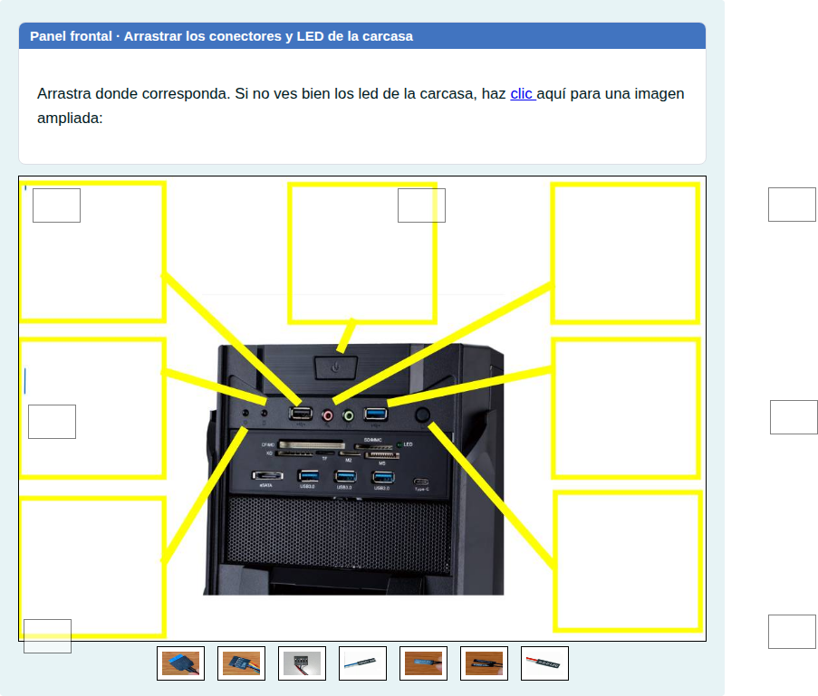
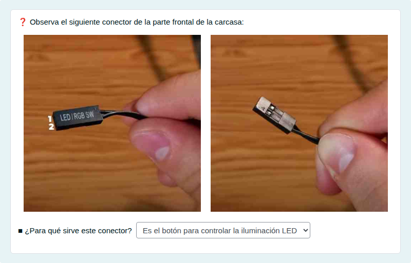
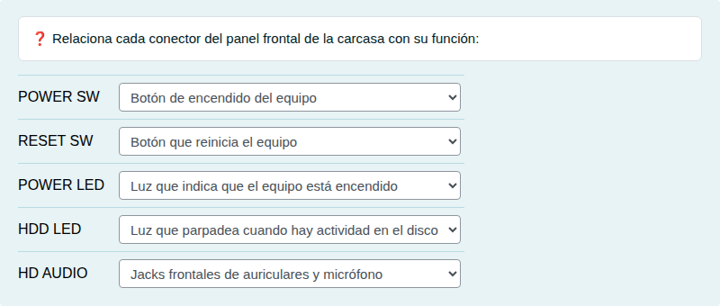
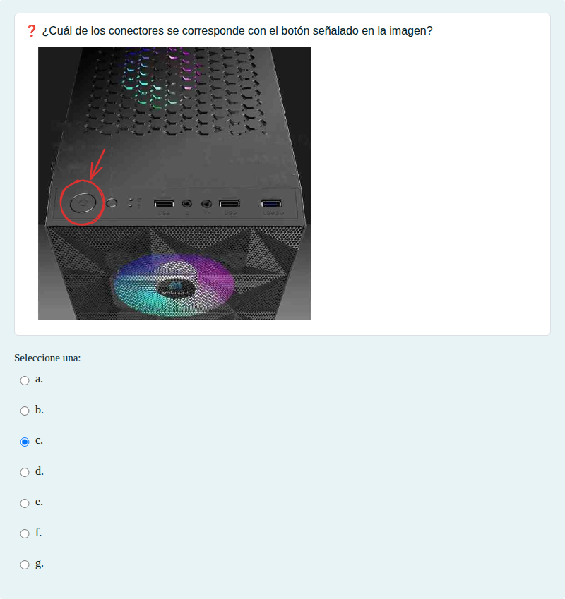
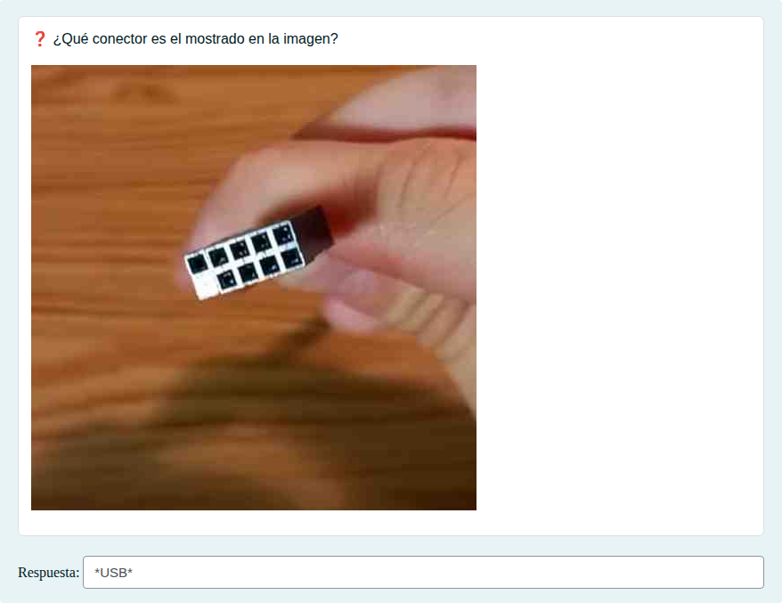

# Conectores del panel frontal

Conectores del panel frontal de la caja (POWER SW, RESET SW, LED, audio y USB) y su función.

## Contenido

Ficheros de preguntas disponibles en esta actividad:

### [conectores-del-panel-frontal.xml](conectores-del-panel-frontal.xml)

|   | Tipo              | Cantidad                   |
| - | ----------------- | -------------------------- |
|  | [Arrastrar y soltar imagen o texto](#arrastrar-y-soltar-imagen-o-texto) | 1 |
|  | [Respuestas anidadas (Cloze)](#respuestas-anidadas-cloze) | 1 |
|  | [Emparejamiento](#emparejamiento) | 1 |
|  | [Selección múltiple](#selección-múltiple) | 1 |
|  | [Respuesta corta](#respuesta-corta) | 1 |
|   | **TOTAL**         | 5 |

#### Arrastrar y soltar imagen o texto

#### Respuestas anidadas (Cloze)

#### Emparejamiento

#### Selección múltiple

#### Respuesta corta

