# El arranque: UEFI, POST y Secure Boot: elegir

Proceso de arranque, firmware, UEFI, POST, orden de arranque, pila y Secure Boot, eligiendo la opción correcta.

## Contenido

Ficheros de preguntas disponibles en esta actividad:

### [el-arranque-uefi-post-y-secure-boot-elegir.xml](el-arranque-uefi-post-y-secure-boot-elegir.xml)

|   | Tipo              | Cantidad                   |
| - | ----------------- | -------------------------- |
|  | [Selección múltiple](#selección-múltiple) | 11 |
|  | [Respuestas anidadas (Cloze)](#respuestas-anidadas-cloze) | 1 |
|  | [Ordenación](#ordenación) | 1 |
|   | **TOTAL**         | 13 |

#### Selección múltiple

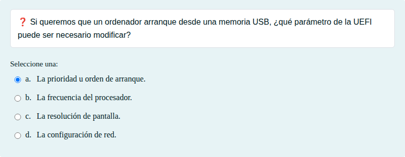

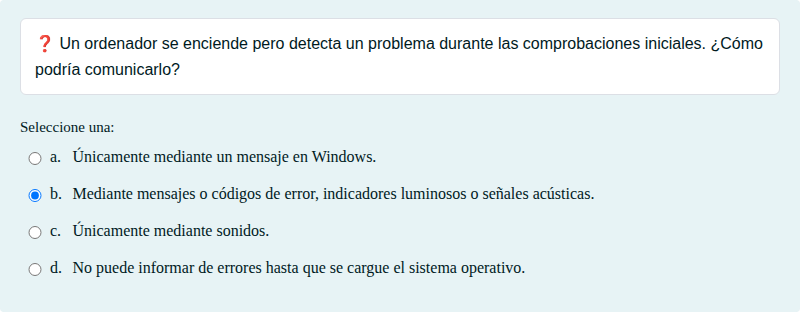

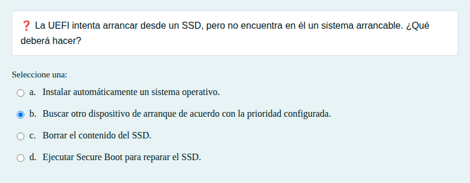

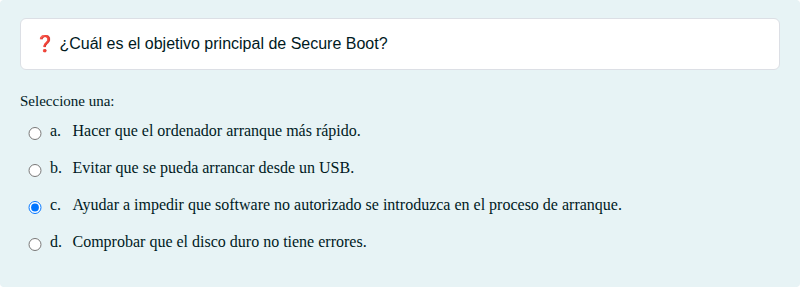

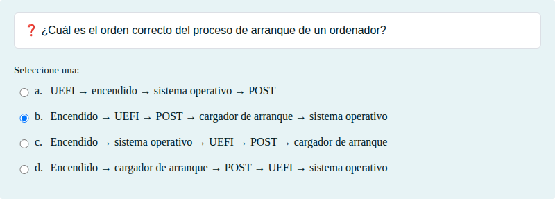

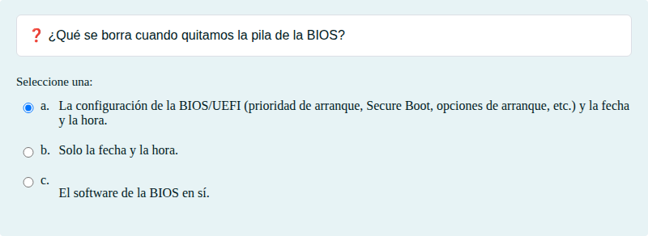

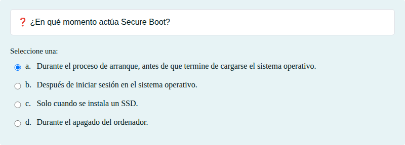

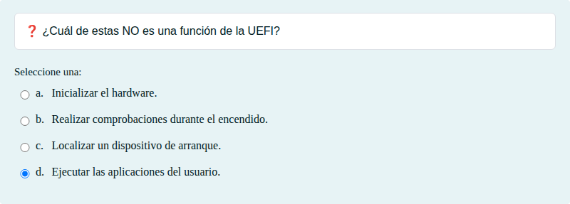

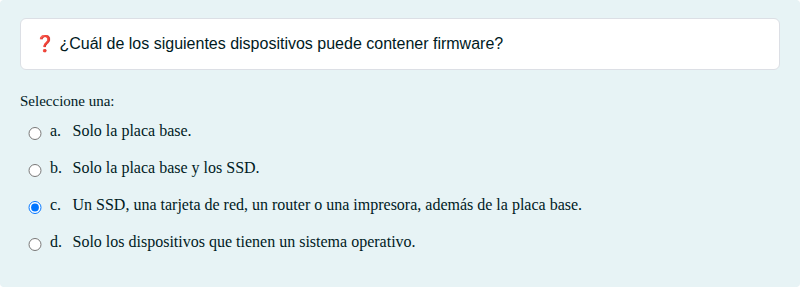

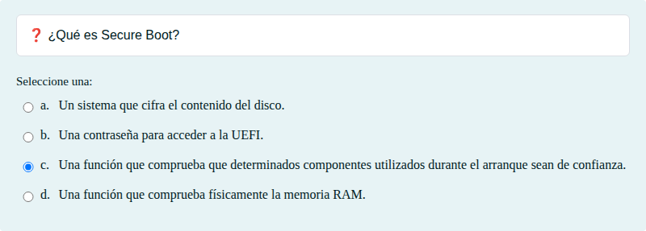

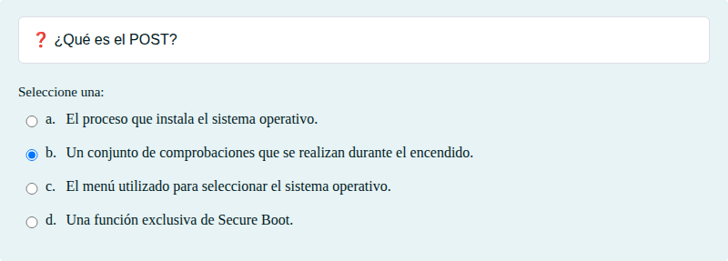

#### Respuestas anidadas (Cloze)

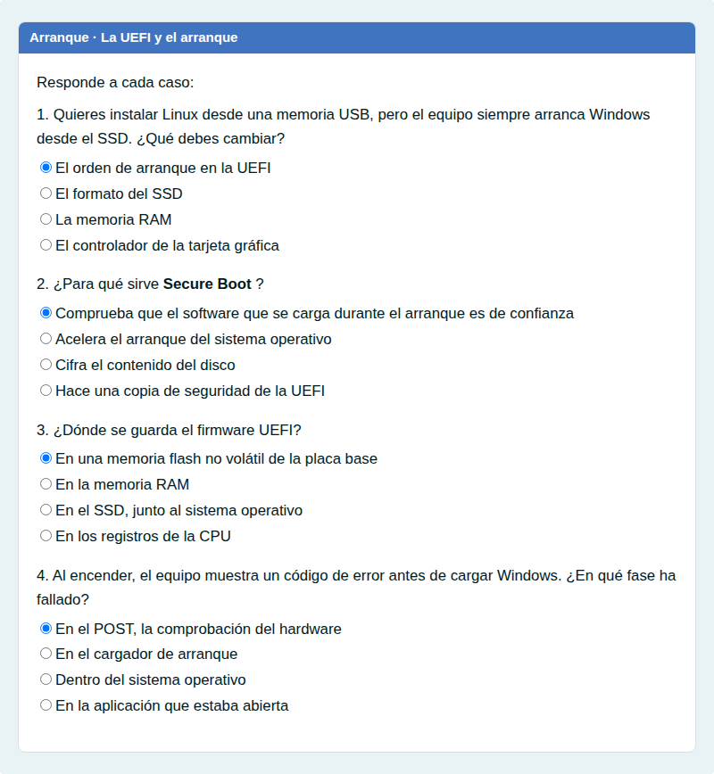

#### Ordenación

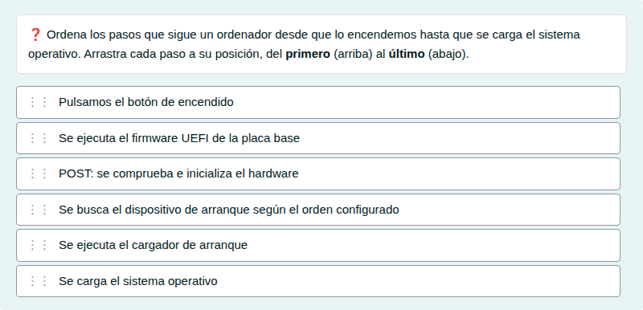

