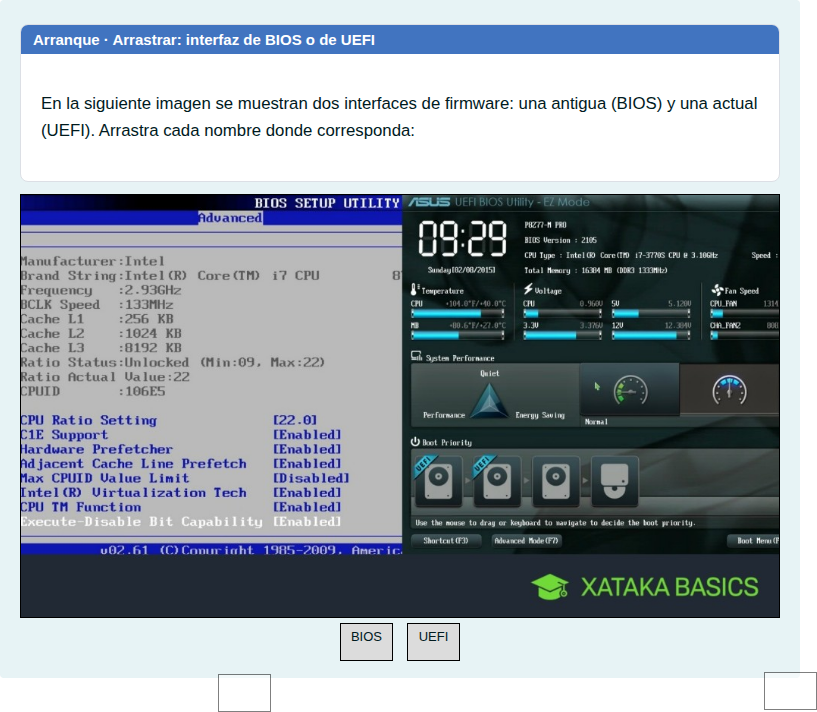
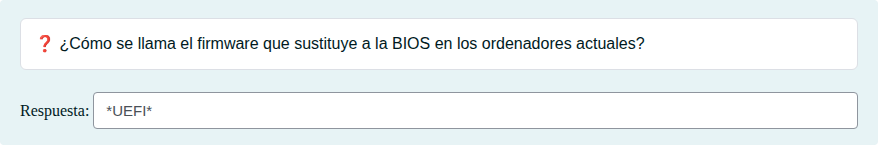
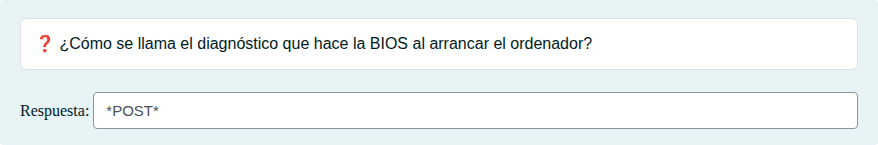
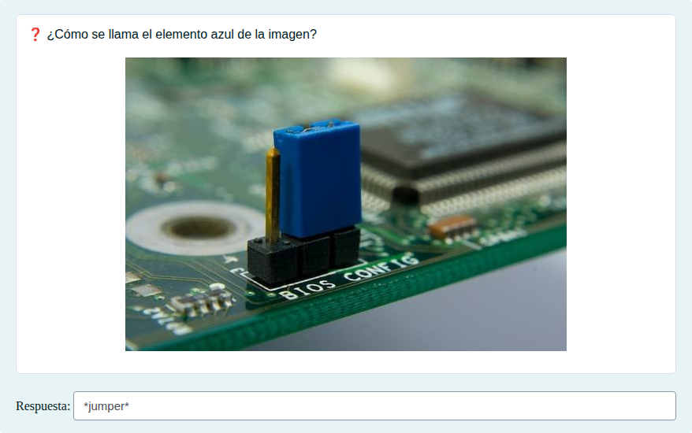

# El arranque: UEFI, POST y Secure Boot: escribir y arrastrar

Nombres del firmware, del POST y del jumper de reseteo, e interfaces de BIOS y UEFI.

## Contenido

Ficheros de preguntas disponibles en esta actividad:

### [el-arranque-uefi-post-y-secure-boot-escribir-y-arrastrar.xml](el-arranque-uefi-post-y-secure-boot-escribir-y-arrastrar.xml)

|   | Tipo              | Cantidad                   |
| - | ----------------- | -------------------------- |
|  | [Arrastrar y soltar imagen o texto](#arrastrar-y-soltar-imagen-o-texto) | 1 |
|  | [Respuesta corta](#respuesta-corta) | 3 |
|   | **TOTAL**         | 4 |

#### Arrastrar y soltar imagen o texto

#### Respuesta corta

