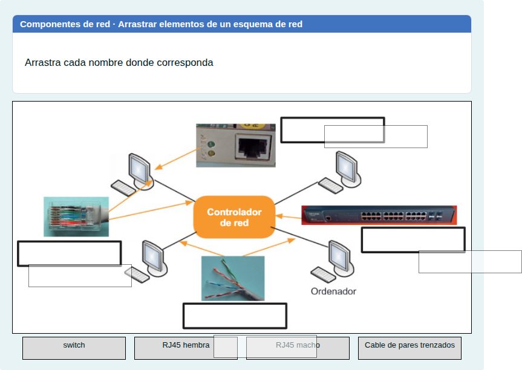
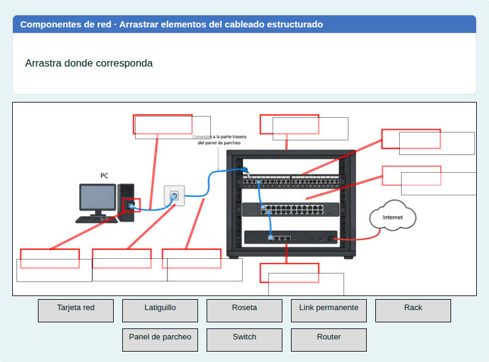
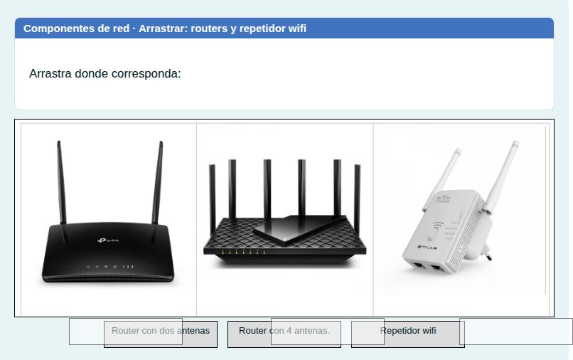
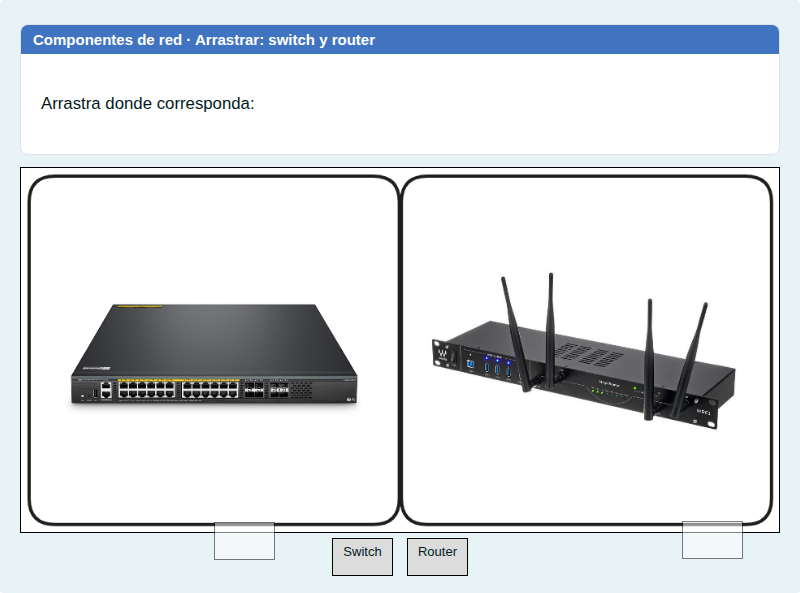
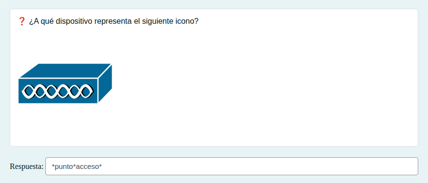
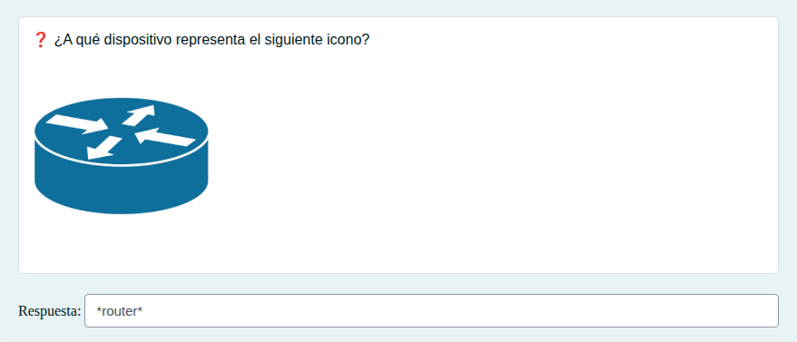
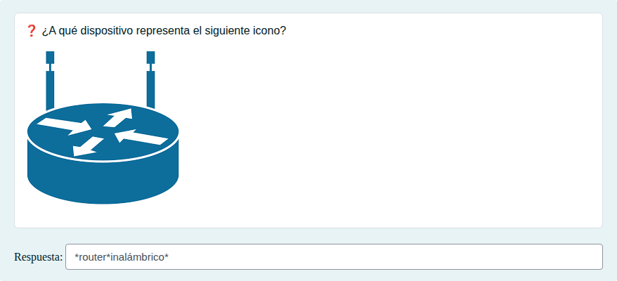
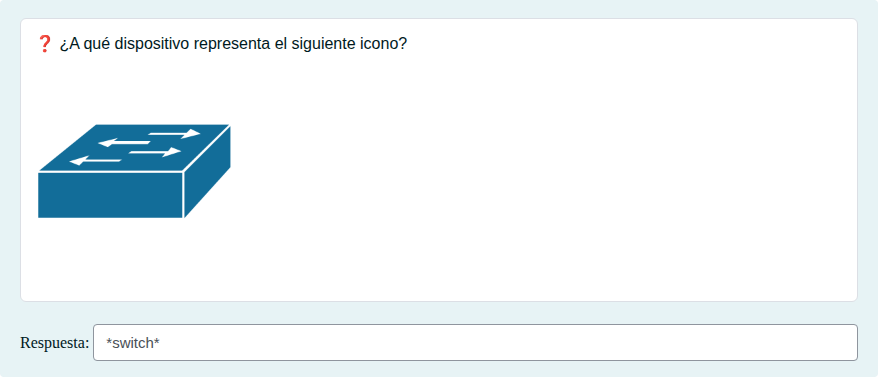
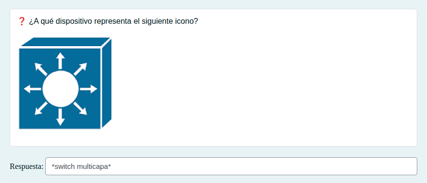

# Componentes de una red local

Identificar los dispositivos y elementos de una red local (switch, router, punto de acceso, rack, roseta…) y sus iconos.

## Contenido

Ficheros de preguntas disponibles en esta actividad:

### [componentes-de-una-red-local.xml](componentes-de-una-red-local.xml)

|   | Tipo              | Cantidad                   |
| - | ----------------- | -------------------------- |
|  | [Arrastrar y soltar imagen o texto](#arrastrar-y-soltar-imagen-o-texto) | 4 |
|  | [Respuesta corta](#respuesta-corta) | 14 |
|   | **TOTAL**         | 18 |

#### Arrastrar y soltar imagen o texto

#### Respuesta corta

