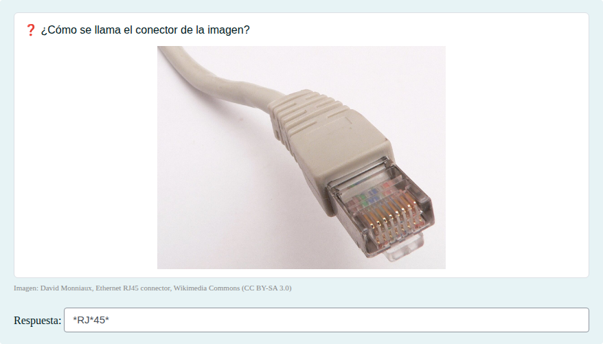
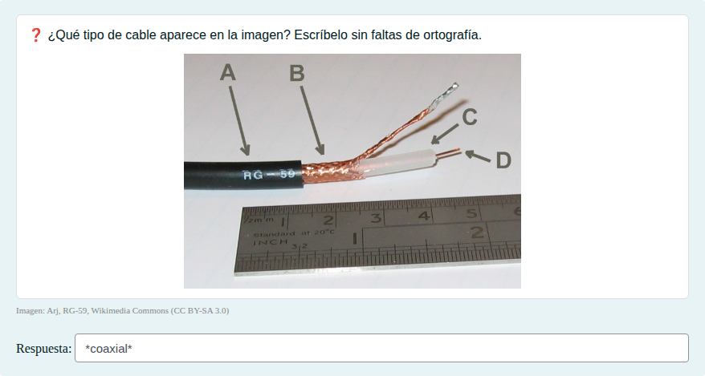
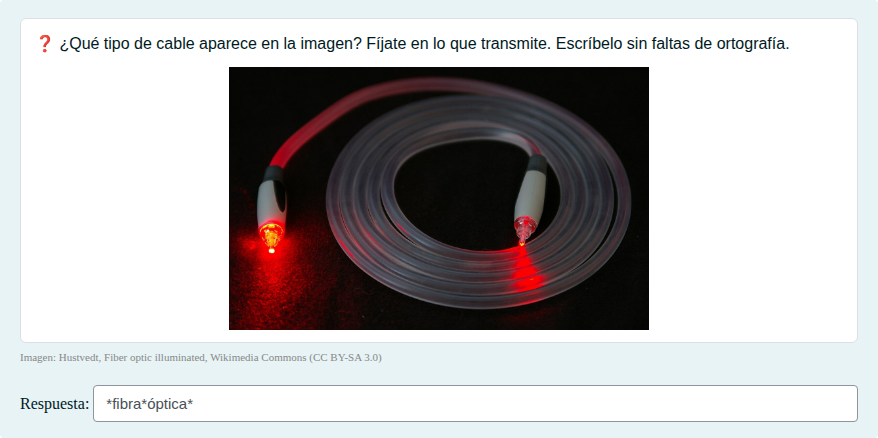
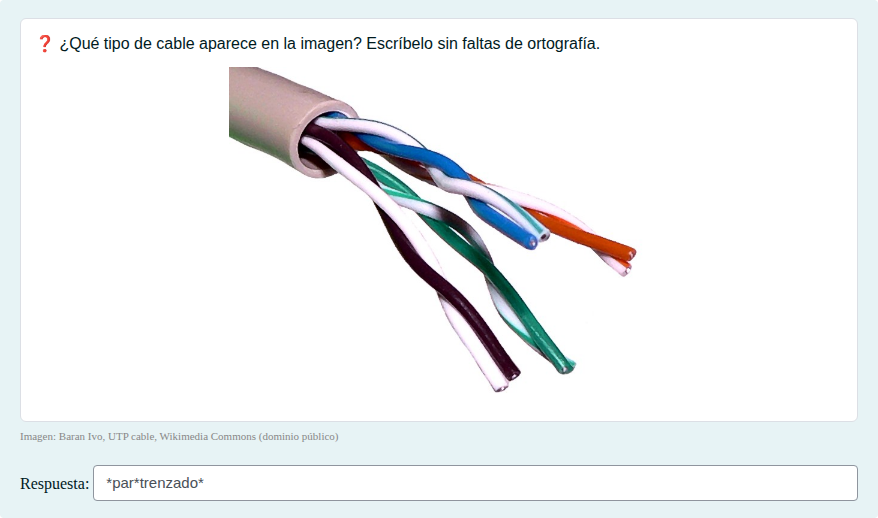
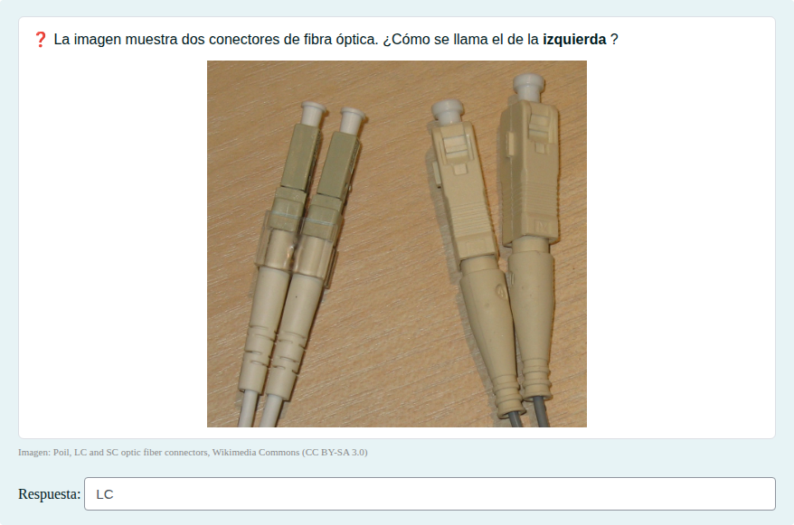
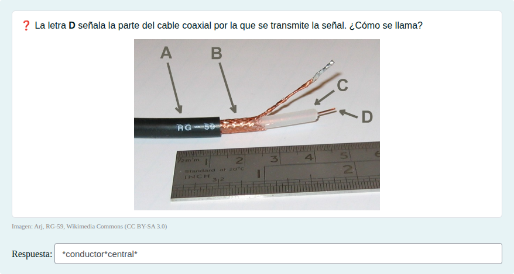

# Medios de transmisión: par trenzado, coaxial y fibra

Identificar cables de par trenzado, coaxial y fibra óptica, sus partes y sus conectores.

## Contenido

Ficheros de preguntas disponibles en esta actividad:

### [medios-de-transmision-par-trenzado-coaxial-y-fibra.xml](medios-de-transmision-par-trenzado-coaxial-y-fibra.xml)

|   | Tipo              | Cantidad                   |
| - | ----------------- | -------------------------- |
|  | [Respuesta corta](#respuesta-corta) | 6 |
|   | **TOTAL**         | 6 |

#### Respuesta corta

