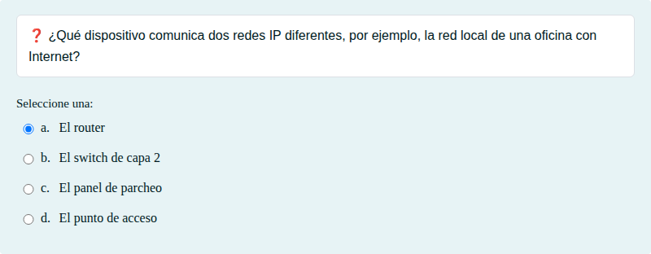
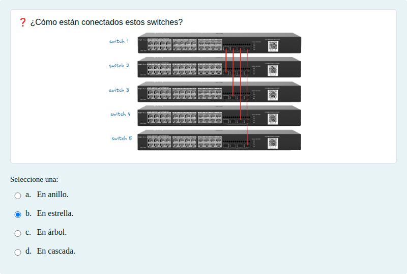
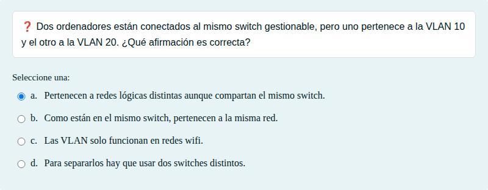

# Dispositivos de red, VLAN y topologías

Switch o router, VLAN y topologías de conexión de switches.

## Contenido

Ficheros de preguntas disponibles en esta actividad:

### [dispositivos-de-red-vlan-y-topologias.xml](dispositivos-de-red-vlan-y-topologias.xml)

|   | Tipo              | Cantidad                   |
| - | ----------------- | -------------------------- |
|  | [Selección múltiple](#selección-múltiple) | 3 |
|   | **TOTAL**         | 3 |

#### Selección múltiple

