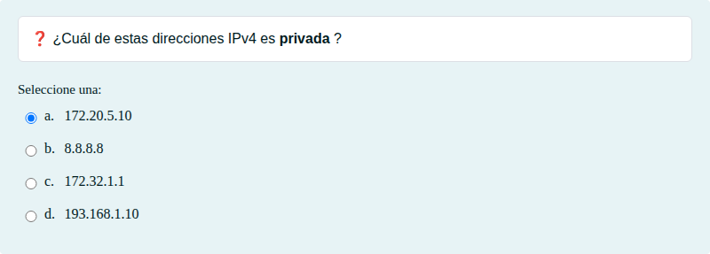
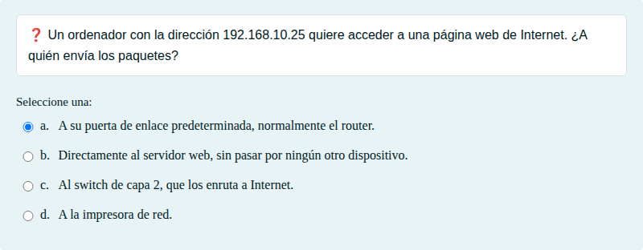
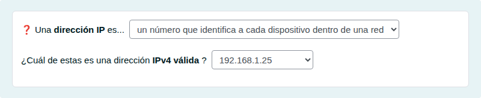

# Direcciones IP: conceptos básicos

Qué es una dirección IP, direcciones privadas y puerta de enlace.

## Contenido

Ficheros de preguntas disponibles en esta actividad:

### [direcciones-ip-conceptos-basicos.xml](direcciones-ip-conceptos-basicos.xml)

|   | Tipo              | Cantidad                   |
| - | ----------------- | -------------------------- |
|  | [Selección múltiple](#selección-múltiple) | 2 |
|  | [Respuestas anidadas (Cloze)](#respuestas-anidadas-cloze) | 1 |
|   | **TOTAL**         | 3 |

#### Selección múltiple

#### Respuestas anidadas (Cloze)

