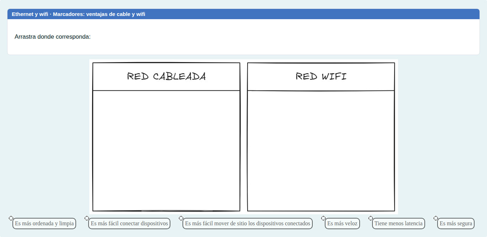
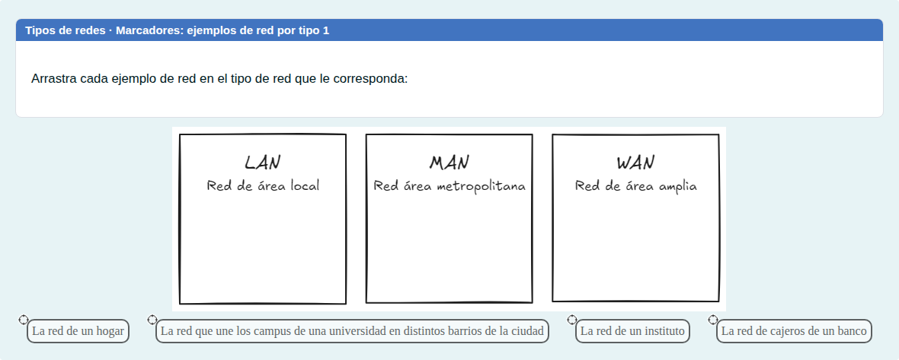
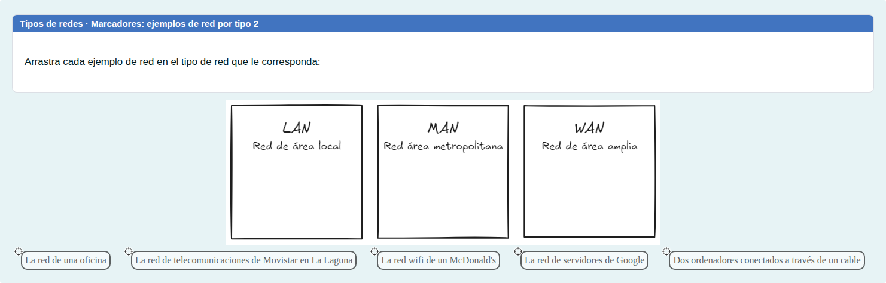
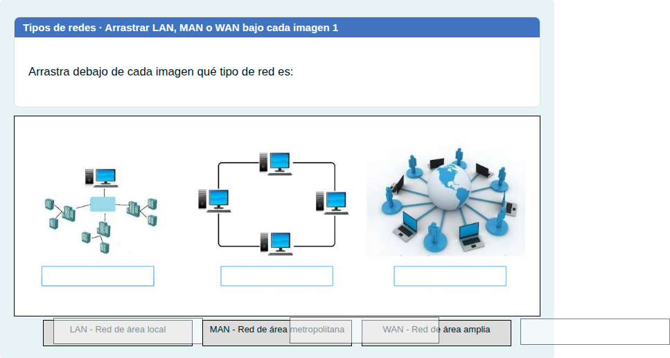
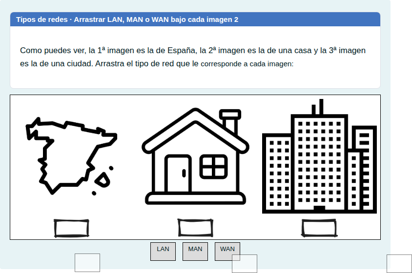

# Tipos de redes, Ethernet y wifi: escribir y arrastrar

Clasificar ejemplos de redes por su alcance y escribir los nombres de los tipos de red y de sus estándares.

## Contenido

Ficheros de preguntas disponibles en esta actividad:

### [tipos-de-redes-ethernet-y-wifi-escribir-y-arrastrar.xml](tipos-de-redes-ethernet-y-wifi-escribir-y-arrastrar.xml)

|   | Tipo              | Cantidad                   |
| - | ----------------- | -------------------------- |
|  | [Arrastrar y soltar marcador](#arrastrar-y-soltar-marcador) | 3 |
|  | [Arrastrar y soltar imagen o texto](#arrastrar-y-soltar-imagen-o-texto) | 2 |
|  | [Respuesta corta](#respuesta-corta) | 3 |
|   | **TOTAL**         | 8 |

#### Arrastrar y soltar marcador

#### Arrastrar y soltar imagen o texto

#### Respuesta corta

